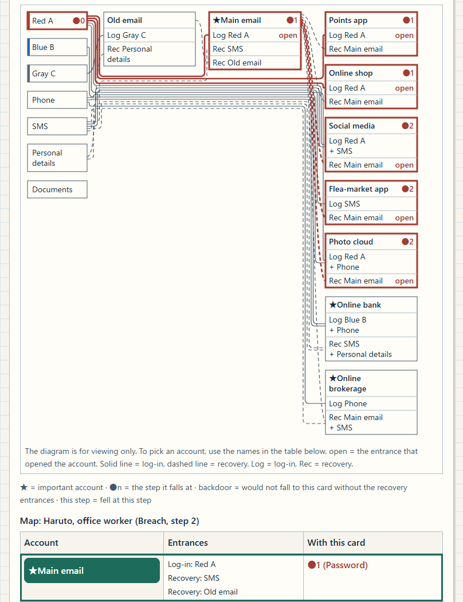
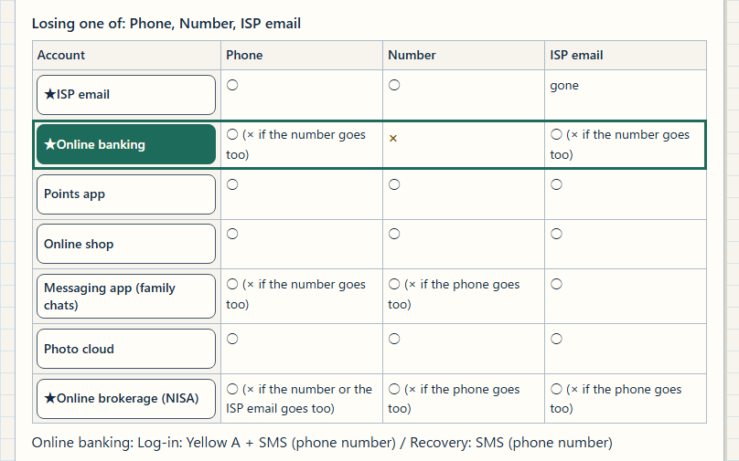
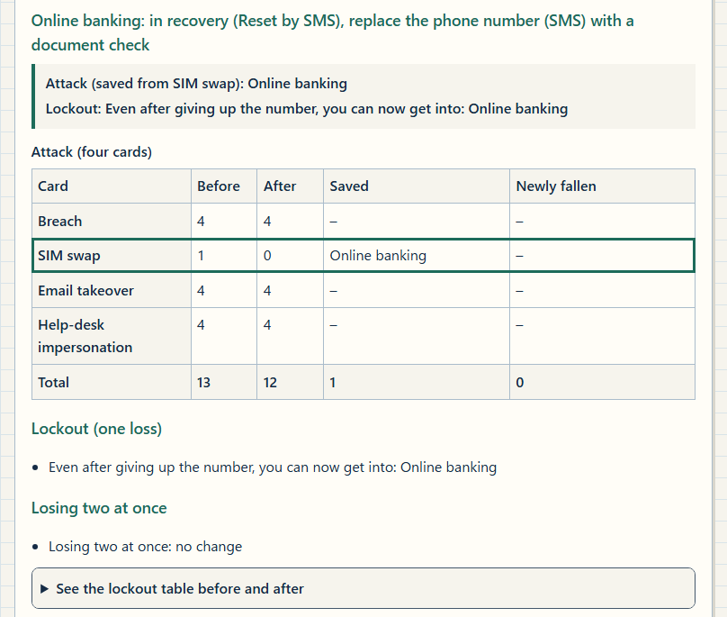

English · [日本語](README.md)

# Account Domino Mapper - A teaching aid that compares account takeover chains and lockouts before and after one change

[](https://github.com/ipusiron/account-domino-mapper/stargazers)
[](https://github.com/ipusiron/account-domino-mapper/forks)
[](https://github.com/ipusiron/account-domino-mapper/commits)
[](LICENSE)
[](https://ipusiron.github.io/account-domino-mapper/)

**Day127 - 200 Security Tools with Generative AI**

Account Domino Mapper is a teaching aid that draws the accounts of three fictional people as a map of log-in and recovery entrances, and compares account takeover chains and the owner's lockouts before and after one change to a single entrance. An account is only as strong as its weakest entrance, whether log-in or recovery. You cannot always prevent a leak, but you can cut the chain yourself.

This is a learning aid. Real account setups are never entered (there are no fields for them). To map your own setup, print the blank sheet and fill it in with symbols.

## 🌐 Demo

👉 **[https://ipusiron.github.io/account-domino-mapper/](https://ipusiron.github.io/account-domino-mapper/)**

Try it directly in your browser. It also works if you download the repository and open `index.html` through `file://`; no build or installation is needed.

The three round buttons at the right end of the header switch light and dark (◐), switch the language (EN; on the English screen the button shows a one-character kanji abbreviation of "Japanese"), and open help and lessons (?). The language is chosen from `?lang=ja` or `?lang=en` in the URL, then a saved choice, then the browser language, in that order. The theme follows the OS setting unless a choice has been saved. Each is saved only when its button is pressed.

Until the page is ready, it shows the notice "Loading diagrams and controls" and keeps the controls disabled. With JavaScript disabled, the explanations can still be read (in Japanese), and the "Reopen in a new tab" link remains.

## 📸 Screenshots

These screenshots show the English screen in light mode. Switch to dark mode with ◐ at the right end of the header, and to the Japanese screen with the language button. Images of the Japanese screen are in [README.md](README.md).



> *Follow the chain: the map at step 2, the last step ("Map: Haruto, office worker (Breach, step 2)"). The main email, the points app and the online shop fall at step 1, and social media, the flea-market app and the photo cloud at step 2: six accounts in all.*



> *Lockout: Online banking selected in the table of the older parent Shizue. It is × in the Number column and ○ (× if the number goes too) in the Phone and ISP email columns, and the line under the table shows its entrances (Log-in: Yellow A + SMS (phone number) / Recovery: SMS (phone number)).*



> *Try one change: the older parent Shizue with "SIM swap" picked under "Prepare for", before and after the first of the top changes, "Online banking: in recovery (Reset by SMS), replace the phone number (SMS) with a document check". The SIM swap no longer topples the bank, and the owner can now get in even after giving up the number.*

## ✨ Features

The teaching aid offers three experiences.

1. Follow the chain: pick one attack card and watch accounts fall step by step along reused passwords and recovery lines. See that an account with multi-factor authentication can still fall through a recovery entrance (it is then marked as a backdoor).
2. See the lockout: when the owner loses the phone, the phone number or an email account, see whether they can still get in with what remains, and whether one more loss would lock them out. A recovery line is a way in for an attacker and, at the same time, the owner's way back.
3. Try one change: make one change to a single entrance (add the phone to a log-in entrance, replace one requirement, or remove one recovery entrance), and compare, before and after on the same screen, how the attack's spread and the lockout change.

| Feature | What it does |
| --- | --- |
| Person (fictional) | Fixed maps of three people: Haruto, office worker (9 accounts, 3 password families); Shizue, older parent (7 accounts, 1 password family); and Mio, student (7 accounts, 2 password families). There are no fields for entering real setups |
| Follow the chain | With one of the four attack cards (Breach, SIM swap, Email takeover, Help-desk impersonation), follow the accounts that fall, step by step from step 0. The map table and the details panel show the entrance used, backdoors and the cards needed to topple each account |
| Lockout | A table with the three loss cards (the phone, the number, an email account) as columns. Each cell is ○ (can get in), ○ with the one more loss that would lock the owner out (such as ○ (× if the number goes too)), × (locked out) or gone (the email itself is gone) |
| Try one change | Shows the top changes in this model for each of the six "Prepare for" options, chosen from the changes of the three people (office worker 41, parent 24, student 24; 89 in all), and compares the attack, the lockout and two-at-once losses before and after |
| Rules | The 10 rules of the model, the list of symbols, 4 notes, the 11 items not in this model, and the print button |
| Highlights | Three per person, nine in all. Pressing one moves to its tab, card, step and change |
| Map diagram | On screens 720px wide or more, a diagram (SVG) that joins credentials and accounts with lines appears above the table. The diagram is drawn without shrinking |
| Printing | Four A4 sheets: the maps of the three people and a blank sheet for writing your own setup in symbols |
| Help and lessons | First time here, Controls, 22 terms, 10 lessons (each with a table; lessons 1 to 9 with sources) and About this learning aid |
| Japanese/English, light/dark | Switches between Japanese and English and between light and dark. Only these two settings, the language and the theme, are saved |

## 📖 How to use

Follow the same order as "First time here" in the help. Start with "Follow the chain" and step through the office worker's breach one step at a time. Next, switch the person to the older parent, press the highlight "Give up the number, and you are locked out of the bank" and see the × in the "Lockout" table. Finally, use "Try one change" for the same person.

1. The page opens on "Follow the chain", showing the office worker Haruto with the Breach card at step 0. Press the first highlight, "One breach, 6 accounts falling", which carries the "Start here" tag, and step through with "Next step ▶". "Start over" returns to step 0, and "Skip to end" moves to the last step. "▶ Play" advances one step at a time by itself and turns into "■ Stop" while it plays. With reduced motion on, "▶ Play" shows the last step at once.
2. Press an account name in the map table, and the details panel ("…: details") shows its entrances, the step at which it falls to this card, the entrance used, whether it is a backdoor, and the cards needed to topple it. On screens narrower than 720px, the focus moves to the heading of the details panel, and "Back to the map table" returns it to the name.
3. When you switch the attack card or the person, the map shows the last step. A hint then appears under the step line (for a card that topples at least one account), saying that "Start over" lets you follow the chain one step at a time from step 0. Open "See all four cards" to compare, in one table (called the four-card table in this README), the step at which each account falls to each of the four cards.
4. In the "Lockout" tab, read the ○ and × in the Phone, Number and email columns. Press a name, and that account's entrances appear in one line under the table (for example, "Online banking: Log-in: Yellow A + SMS (phone number) / Recovery: SMS (phone number)").
5. In the "Try one change" tab, pick an option under "Prepare for" (Breach, SIM swap, Email takeover, Help-desk impersonation, All four cards, Fewer lockouts), then press a change under "Top changes in this model". The line under that heading gives the meanings of ★ (important account) and "Sum over the four cards" (counted for each of the four cards and added up). The first change in the list ranks first in this model, and "How changes are ranked" explains the order. Other changes can be picked from "Choose a change yourself".
6. The comparison appears under a heading that states the change, in this order: the summary, "Attack (four cards)", "Lockout (one loss)" and "Losing two at once". "See the lockout table before and after", "Compare other changes to the same entrance" and "See the map after the change" ("Before" and "After") show the same change in other forms. After you press a change in the same-entrance table, "Back to the comparison" returns to the heading that states the change.
7. In the "Rules" tab, read the rules, symbols and notes of the model. To apply it to your own setup, print the sheets with "Print (three maps and a blank sheet)" under "Apply it on paper", and write in symbols. The guide to printing at the end of the "Follow the chain" tab (a button) also leads here.
8. Open "Help and lessons" with "?" in the header. Move between tabs with ← →, Home and End, and close the help with Esc.

The "Follow the chain" tab shows the three highlights of the person selected under "Person (fictional)".

| Person | Highlight | Where it goes |
| --- | --- | --- |
| Haruto, office worker | One breach, 6 accounts falling | Follow the chain, Breach, step 0 |
| Haruto, office worker | Replace the main email's backup email with paper codes | Try one change, All four cards |
| Haruto, office worker | Remove the brokerage re-registration, and losing the phone locks you out | Try one change, SIM swap |
| Shizue, older parent | One SIM swap, and the bank falls | Follow the chain, SIM swap, last step |
| Shizue, older parent | Give up the number, and you are locked out of the bank | Lockout, Online banking |
| Shizue, older parent | Move the bank reset to a document check: one change stops both | Try one change, SIM swap |
| Mio, student | From a game breach to the brokerage | Follow the chain, Breach, step 0 |
| Mio, student | University email taken over: all 7 | Follow the chain, Email takeover, last step |
| Mio, student | Graduation locks you out of the video subscription | Lockout, Video subscription (student plan) |

Printing produces four sheets in the current screen language. Sheets 1 to 3 hold each person's map table (the four attack cards and the three "When lost" columns) and the model's caveat; sheet 4 is "My map (fill in with symbols)". The "Keep safe (map of weak points)" box at the top of sheet 4 has fields for the date written, where the sheet is kept and the review date. Below it, write in symbols, without passwords, in the 18 empty rows of the table. Printing from the browser menu gives the same four sheets, printed in black text even in dark mode.

## 📐 Screen layout

| Area | Contents |
| --- | --- |
| Header | The title, and three round buttons at the right end (◐ = light and dark, EN = language (a kanji on the English screen), ? = help and lessons) |
| Introduction | What the maps of three fictional people let you check, and that an account is only as strong as its weakest entrance |
| Person (fictional) | Buttons for the three people (Haruto, office worker; Shizue, older parent; Mio, student) and a line with the numbers of accounts and password families |
| Tabs | Follow the chain, Lockout, Try one change, Rules |
| Footer | One link, GitHub (ipusiron/account-domino-mapper) |

Inside the tabs, the help and the print section, the parts appear in this order from the top.

- Follow the chain: introduction, the "Start here" line (office worker only), the story, highlights, the attack cards and a line describing the selected card, step controls, the step line and the step summary, the map diagram (720px wide or more), the legend (★ = important account, ●n = the step it falls at, backdoor, this step), the map table, the details panel, "See all four cards", notes for each card, and the guide to printing
- Lockout: introduction, the column legend, the lockout table, the line with the entrances of the selected account, and three notes
- Try one change: introduction, "Prepare for", "Top changes in this model" (under the heading, a line with the meanings of ★ and "Sum over the four cards", then the candidates) with "How changes are ranked", "Choose a change yourself", and the comparison (summary, "Attack (four cards)", "Lockout (one loss)", "Losing two at once", "See the lockout table before and after", notes, "Compare other changes to the same entrance", "See the map after the change")
- Rules: the 10 rows of "Rules (a simplified model)", "Symbols", four notes, "Not in this model" and "Apply it on paper"
- Help and lessons: "First time here", "Controls", "Terms" (22 terms), "Lessons" (10 sections) and "About this learning aid"
- Print section: four sheets with the three maps and the blank sheet (hidden on screen, shown only when printing)

The map table has three columns: "Account", "Entrances" and "With this card". The "With this card" column shows the step at which the account fell with the entrance used (for example, ●1 (Password)), what the card gave directly (●0 (given by the card)), "backdoor", or "–" for an account that has not fallen yet or does not fall. Rows that fell at the current step get a thick line on the left and the words "this step". The map table, the diagram and the step line follow the current step; the step summary, the details panel and the four-card table always show the result at the last step.

The map diagram is for viewing only; pick accounts by their names in the table below it. In the diagram, a solid line is log-in and a dashed line is recovery. "open" marks the entrance that opened the account, "Log" is log-in and "Rec" is recovery.

Across the screen, so as not to rely on color alone, the step at which an account fell (●n), backdoors, lockout (×), a vanished email (gone) and the entrance used (open) are shown as text, and password families are written as a color word and a letter (Red A).

| Part | 720px wide or more | Narrower than 720px |
| --- | --- | --- |
| Map diagram (SVG) | Shown above the table at 14px text, without shrinking. On a screen 720px wide, the diagrams of the office worker and the student (704 wide) scroll sideways inside the diagram frame | Not shown (table only) |
| Map table | Three columns (Account, Entrances, With this card) | Two columns (the entrances under the name, the result with this card on the right) |
| Lockout table | Four columns (Account and the three loss cards) | Still four columns |
| Attack (four cards) | The numbers before and after, and the names of the accounts saved and newly fallen | Five columns of numbers only; the names open under "See the account names" |
| Symbols, lockout table before and after, same-entrance table | Tables | Stacked vertically |
| Details panel | Pressing a name does not move the focus | Pressing a name moves the focus to the heading of the details panel, and "Back to the map table" returns it to the name |

## 🔬 Technical notes

The model is the account access graph of the paper "User Account Access Graphs" by Hammann et al. (CCS 2019), cut down to what this teaching aid needs. For each person, the credentials (password families, the phone, the phone number, personal details and the document check) and the accounts are nodes, and each entrance of an account has one rule: it opens when these requirements are met. `domino-core.js` does the calculation, and `domino-view.js` builds the screen's sentences, tables and diagram coordinates.

- Entrance: a way into one account. There are log-in entrances and recovery (reset) entrances. It corresponds to a "color" in the paper.
- AND: an entrance opens only when all of its requirements are met (edges of the same color in the paper).
- OR: when any one entrance opens, the account can be entered (edges of different colors in the paper).
- Reach: the set of accounts found by starting from what one holds at first (for the attacker, what the card gives; for the owner, the credentials in their hands), adding the accounts with an entrance whose requirements are all met, and stopping when nothing new opens (the least fixed point of Definition 3 in the paper). The tool counts the unmet requirements of each entrance and adds the account when the count reaches 0, so the work is proportional to the number of lines (the Horn-clause method of Dowling and Gallier).
- Step: step 0 is what the card gives. Step r is what opens through an entrance whose requirements were all met by step r−1. The entrance used is the first such entrance in data order.
- Lockout: once what the owner lost is removed from the graph, the accounts the owner cannot reach by the same rules from the credentials left in their hands (the complement of reach). Before the loss, the owner is taken to hold every credential. A vanished email itself is shown as "gone" and is not counted as locked out.
- Backdoor: an account that falls to the card but does not fall in the graph with all recovery entrances removed. It is Definition 26 of the paper made yes-or-no, without scores.

A naive reach that treats every line as OR (breadth-first search) gets AND wrong. On the maps of the three people, it would wrongly make the office worker's online bank fall to the SIM swap, and the parent's online banking, messaging app (family chats) and online brokerage (NISA) fall to the breach. The office worker's online bank resets with SMS + personal details, so the SIM-swap card alone does not topple it (the example of rule 2).

Definition 18 in the paper defines lockout as a least fixed point. This teaching aid counts lockout as the complement of reach. The next two points were derived and checked for this teaching aid. First, the complement equals the greatest fixed point of the rules of Definition 18 when the owner holds every credential that no line leads into, which is always the case in this teaching aid. Second, computing Definition 18 as a least fixed point can miss lockouts in a cycle where two emails back each other up. In a cycle where Email A and Email B back each other up, losing both password a and password b locks the owner out of both Email A and Email B when lockout is counted as the complement, while the least fixed point of Definition 18 shows no lockout (the table in lesson 9). This is why lockout is counted as the complement. The maps of the three people have no cycle, so both ways give the same result.

The Breach card gives the password family that the breached service (the points app for the office worker and the parent, the game for the student) uses to log in now. The family is not fixed in advance; it is computed from the data each time. So after a change that gives the breached service a password family of its own, the Breach card gives only that new family, and the breach does not spread to the accounts that reused the old one. For all three people, this change is the first of the top changes for Breach, and after it only the breached service itself falls. The card stands for the case where that family has leaked as-is (in plain text), together with the ID (rule 5).

The rules are the same 10 rows as in the "Rules" tab on the screen.

| # | Rule |
| --- | --- |
| 1 | An account has entrances: log-in entrances and recovery (reset) entrances |
| 2 | All requirements of one entrance must be met (AND), e.g. password + SMS code |
| 3 | Any one entrance is enough (OR) |
| 4 | The attacker starts from what the card gives and uses every opened email for further entrances, until nothing new opens. Each round of newly opened accounts is one step |
| 5 | Passwords are families (color + letter). The same family counts as the same secret everywhere, small variations included. A breach card stands for the case where the family that the breached service now uses to log in has leaked as-is (in plain text), together with the ID; then the password requirement is met on every entrance that uses that family, however long the password is |
| 6 | An SMS requirement is met by the phone number; the attacker holds it only with the SIM-swap card |
| 7 | A phone help desk accepts personal details; no card defeats a document check (photo ID, postal mail) |
| 8 | Passkeys and authenticator apps are treated as keys inside the phone; paper recovery codes exist only in the owner's hands |
| 9 | Lockout: after removing what the owner lost (one thing, or two at once), the accounts they cannot reach by the same rules from what remains. A vanished email itself is shown as gone and is not counted as locked out. Forgetting a password is not modeled |
| 10 | Time, probability, notifications and detection of suspicious log-ins are not modeled |

The "Rules" tab always shows the following four notes.

Note 1 (SMS): An SMS line opens for the attacker only with the SIM-swap card. The study behind it (Lee et al., SOUPS 2020; carrier tests run in 2019) covered five US prepaid carriers and is not applied to Japanese carriers.

Note 2 (passkeys and the phone): Passkeys and authenticator apps are treated as keys inside the phone. So passkeys' resistance to fake sites does not show in the numbers. Retrieving synced passkeys through cloud-account recovery, and takeover through an infected device, are outside this model. No card here hands the phone to the attacker, so adding the phone never makes the attack side worse. The "Lost the phone" values assume the authenticator app and passkeys are not synced or backed up to another device or the cloud.

Note 3 (help desk): A phone help desk accepts personal details. This model has no card that defeats a document check and no card for the owner losing their documents, so moving a line to a document check never makes the attack or the lockout worse here. In reality documents can be forged, and recovery at a desk takes time. Real identity-check procedures are not described.

Note 4 (paper codes): Paper recovery codes exist only in the owner's hands. No card here hands the paper codes to the attacker, so moving a line to paper codes never makes the attack side worse. In reality, where you keep them becomes a new entrance, and they are not phishing-resistant when you type them in. On the lockout side, losing the paper codes together with something else can lock you out. To keep them split across places, see [Day124 Scatter Seeds](https://ipusiron.github.io/scatter-seeds/) and [Day125 Overlay QR Shares](https://ipusiron.github.io/overlay-qr-shares/).

The changes are generated exhaustively from the entrances of the three maps (office worker 41, parent 24, student 24; 89 changes in all).

- Add: add the phone (authenticator app, passkey) to a log-in entrance, only when the account offers multi-factor authentication and the entrance does not have the phone yet (12 changes for the three people).
- Replace: replace one requirement of an entrance. An email can be replaced with another email (log-in and recovery) or with paper recovery codes (recovery only); SMS with the phone (log-in) or with paper recovery codes or a document check (recovery); personal details with paper recovery codes (recovery only) or a document check; and a password family with a family used only by that account (only when another account uses the same family). Only methods the account offers are used (53 changes for the three people).
- Remove: remove one recovery entrance. Log-in entrances are never removed. Removing an entrance with two requirements removes two lines (24 changes for the three people, 4 of which remove an entrance with two requirements).

In this model, the changes toward documents, paper codes or the phone (40 changes: 7 replacing with a document check, 17 replacing with paper codes, 12 adding the phone and 4 replacing with the phone) make no new account fall, and none of them adds a lockout after a single loss. Still, 20 of them change nothing in the attack, so such a change is not necessarily an improvement. Once two-at-once losses are counted, 9 of the changes to paper codes and 3 of the changes that add the phone create a new pair of losses that locks the owner out. They never make the attack side worse because this model has no card that hands documents, paper codes or the phone to the attacker. A change to a document check does not make the lockout worse either, because there is no card for the owner losing documents (note 3). In reality, documents can be forged.

The candidates in "Try one change" are ranked for each of the six "Prepare for" options. For the options of one attack card (Breach, SIM swap, Email takeover, Help-desk impersonation) and for "All four cards", changes that add even one lockout after a single loss go last. The rest are ranked by ★ (important) accounts saved on balance (more first), then accounts saved on balance (more first), then the change in lockouts (smaller first), then accounts newly falling, summed over the four cards (fewer first). For "Fewer lockouts", the order is the change in lockouts (largest decrease first), then accounts newly falling, summed over the four cards (fewer first), then ★ accounts saved on balance, summed over the four cards (more first), then accounts saved on balance, summed over the four cards (more first). On balance means the accounts saved minus the accounts newly falling to the same card. For "All four cards" and for "Fewer lockouts", both are sums over the four cards: counted for each of the four cards and added up (the same account can be counted more than once). Ties go add → replace → remove.

"Top changes in this model" shows only the changes that meet a condition, in ranking order, at most one per entrance and up to three. For the options of one attack card and for "All four cards", the condition is that a change saves a positive number on balance without adding a lockout after a single loss. For "Fewer lockouts", the condition is that a change reduces lockouts. So the first of the top changes is the first change in the ranking that meets the condition. When no change meets it, no top changes are shown and the reason is given instead ("Fewer lockouts" for the office worker, and "Help-desk impersonation" for the student). Two-at-once losses are not used for ranking; they are added to a candidate's button as "New two-at-once lockouts".

The online brokerages on the three maps are a fictional setting: a passkey is required to log in, and a recovery line that re-registers the passkey remains. No company's procedure is copied. Mio's (the student's) re-registration by registered email alone is a setting chosen for teaching; it is weaker than the fallback lines seen in brokerages' public FAQs (such as password plus SMS authentication). For the office worker's brokerage, the email in the re-registration requirement "email + SMS" opens through SMS, so the brokerage falls at step 2 to a single SIM swap even though a passkey is required. Infected devices are outside the model.

`domino-core.js` (calculation), `domino-data.js` (the three people's data), `domino-view.js` (candidates, sentences and map coordinates) and `messages.js` (Japanese and English dictionaries) are ordinary scripts in UMD form. They have no external dependencies and do not depend on the DOM, so Node.js can load them with `require` (the tests load them this way). Only `app.js` handles the DOM. Each person's calculation runs once and is kept; switching the language or theme does not recompute it. For the map after a change, two caches hold the step results (one entry per person, change and card) and the diagram coordinates (one entry per person, change and language). Each keeps at most eight entries; when a ninth is added, the least recently used one is dropped. The diagram coordinates are set per person from the data order and the depth of dependencies between emails, without a force-directed layout (the diagrams are 704 wide for the office worker and the student, and 532 for the parent). A line that crosses two or more columns runs along the vertical lanes between columns and the passage left open below the row of cards, so that it does not overlap the cards of the columns in between. The sampled points of the lines, used to check that lines do not overlap, are made only when a test asks for them.

## 🎯 Use cases

Ways of using this tool in particular

1. Find the email where recovery lines converge (at home or in workplace training): in "See all four cards", look for the account that falls to every card. For the office worker, the main email falls to all four cards, and a single card topples 6–7 of the 9 accounts, whichever of the four it is (the main email included). Of those, 3–5 fall through recovery lines that require the main email. Ask the same question of your own setup by writing it on the sheet in symbols. (In training, too, each person keeps their own filled-in sheet; sheets are not collected or shown to others.)
2. Two keys that trace back to one phone number (a discussion of whether multiple factors are independent): the office worker's brokerage re-registration, "email + SMS", falls at step 2 to one SIM swap (because the email opens through SMS; the details panel reads "Cards needed: SIM swap alone").
3. A logic class (AND/OR): explain, with the AND inside an entrance, why the office worker's online bank does not fall to one SIM swap alone (its reset needs SMS + personal details, so it takes two cards together: the SIM swap and Help-desk impersonation).
4. Weighing removal against replacement: of the 89 changes of the three people, 10 add a lockout after a single loss, and all of them are removals (10 of the 24 removals). Counting two-at-once losses, 3 additions and 15 replacements also create a new pair of losses that locks the owner out. Replacing a line with paper codes can move such a pair or create a new one (and some changes leave the pairs as they are).
5. Counting entrances does not measure the margin before a lockout: the parent's bank has two entrances, but both use the phone number, so giving up the number alone locks the owner out (in the Phone column, too, the cell reads ○ (× if the number goes too)).
6. Talk it over as a family: print the older parent's map and talk about where things rely on a single phone number. One SIM swap topples the bank, and giving up the number locks the owner out of it. One change, moving the bank's reset to a document check, stops both (the model leaves out forged documents and the owner losing documents, so in this model a change to a document check makes neither the attack nor the lockout worse; the printed sheets also carry the model's caveat).

Other ways of using it

- Information literacy classes: a teacher picks the Breach card on the map of Mio, the student, and shows the free email, social media and the game falling at step 1 through the reuse of Green A, then the flea-market app and the online brokerage (monthly investing) falling at step 2. Password reuse and credential stuffing can be explained as what follows from one breach.
- Workplace training: IT staff show, with the Help-desk impersonation card, how accounts fall from a help-desk line, and use the lockout table to discuss when owners lose access, such as when someone leaves the company or changes phones.
- Phone help-desk training: call-center staff use the Help-desk impersonation card to see which accounts fall from a help-desk line that accepts personal details alone, and learn that an identity check can also be where a chain starts.
- Everyday life: a student about to graduate, or someone who helps a parent with phone settings, looks at the student's highlight "Graduation locks you out of the video subscription" and the parent's highlight "Give up the number, and you are locked out of the bank" before graduating, canceling an internet provider or changing a phone number, and reviews their own or the family's recovery addresses.
- Fiction and games: authors of mystery novels or escape games check whether a chain of account takeovers in their plot fits the rules in the "Rules" tab. It is not meant as a how-to for attacks.
- Research: students and researchers in computer science, as an introduction to the formalism of Hammann et al., check the least fixed point of reach and the cycle counterexample to Definition 18 (lesson 9) on small examples.
- Combinations: after looking at intrusion paths through buildings and networks in Day083 Intrusion Path Mapper, look at the account lines in this teaching aid. Connect it with Day124 Scatter Seeds and Day125 Overlay QR Shares for keeping paper recovery codes split, Day001 Password Checker for password strength, Day019 PassCloud for the overlap rate of reuse, and Day060 Reverse Brute-force Demo for password spraying.

Limits

- This is a simplified model, and no real service's procedure is copied. Real services also detect suspicious log-ins and send notifications.
- How Japanese carriers check identity before reissuing a SIM has not been confirmed. The SIM-swap card models what happens when a swap succeeds.
- Retrieving synced passkeys through cloud recovery, and infected devices, are outside the model.
- Forged documents and forgetting a password are outside the model.
- In this model, a change toward documents, paper codes or the phone never makes the attack side worse (but is not necessarily an improvement). In reality, documents can be forged, and paper codes can be seen or stolen where they are kept.
- Time, probability, detection and notifications are not modeled.
- It is not a tool for examining the settings of your own accounts. Think through your own setup by writing it in symbols on the printed sheet.

## 🔒 Security

- The CSP is `default-src 'none'; script-src 'self'; style-src 'self'; img-src 'self' data:; base-uri 'none'; form-action 'none'; frame-src 'none'; object-src 'none'; connect-src 'none'` (set by a meta element in `index.html`).
- The referrer is not sent (`<meta name="referrer" content="no-referrer">`).
- There are no fields for typing text (no text `<input>`, `<textarea>` or `contenteditable`). The only things to choose are buttons and the "Choose a change yourself" list.
- Only two things are saved, the language and the theme (localStorage keys `account-domino-mapper.language` and `account-domino-mapper.theme`). Nothing is saved on the first visit; a choice is saved only when its button is pressed.
- There is no external communication (no `fetch`, `XMLHttpRequest` or WebSocket, and the CSP's `connect-src 'none'` blocks it as well). No external scripts, styles or fonts are loaded.
- The screen text is built from elements and text nodes; `innerHTML` is not used.
- External links (lesson sources, related tools, GitHub) are ordinary links without `window.open` (`target="_blank" rel="noopener noreferrer"`), so they open in a new tab without relying on JavaScript.
- The printed sheet has a "Keep safe (map of weak points)" box, which asks you not to photograph the sheet or send it through cloud storage or messages.

Password reuse information is treated as something that can help attackers even without the passwords themselves (Mozilla's Password Reuse Visualizer wiki: "Password reuse data, even if unaccompanied by actual passwords or password hashes, can be of use to attackers."). Some tools also treat the shape of the connections between accounts as something to protect apart from the passwords (the Lattice README: "The graph *topology* (which nodes connect to which) is treated as sensitive on its own, not just individual passwords."). For this reason, the screen has no fields for real setups, and your own setup is written in symbols on a printed sheet.

Loading the published page and opening source links involve normal network requests. The tool has no feature that sends anything you enter, and there are no input fields.

Sources: [Mozilla, "Identity/Watchdog/Password Reuse Visualizer"](https://wiki.mozilla.org/Identity/Watchdog/Password_Reuse_Visualizer), [the Lattice README](https://github.com/vexselene/lattice)

## ⚠️ Notes and limits

**This teaching aid is not a tool for examining the settings of your own accounts.** The results come from the 10 rules of the Rules tab and the settings the author chose for three fictional people. Real services' procedures differ from company to company and may change. Do not enter your own setup on the screen; think it through by writing it in symbols on the printed blank sheet.

- The research figures in the lessons (in the help) come with the year and scope of each study. The study behind the SIM swap (Lee et al., SOUPS 2020) covered five US prepaid carriers in 2019 and is not applied to Japanese carriers.
- The "Lost the phone" values assume the authenticator app and passkeys are not synced or backed up to another device or the cloud.
- Not in this model (the same list as in the Rules tab): password strength; attack probability, effort and time; detection of suspicious log-ins and notifications; retrieving synced passkeys through cloud recovery; infected devices; forged documents; forgetting a password; single sign-on and password managers; an attacker changing recovery details after a takeover; leaks where the passwords are protected by hashing and cannot be cracked; and phishing on fake sites (which passkeys resist). Authenticator apps and passkeys are both treated as keys inside the phone (rule 8), so passkeys' resistance to fake sites does not show in the numbers.
- On screens 320px wide, only the lockout tables of the parent (Japanese) and the student (English) break words in the middle to fit the table in the panel (English adds hyphens). The other tables, and all tables at other widths, do not break words in the middle.
- When a screen reader reads the page in order, the same step sentence can be read twice, because it remains both in the step line and in the announcement for screen readers.
- The browsers checked are Chromium and Firefox.

Not in this teaching aid

- A feature for building your own map, input fields, saving anything other than the language and theme, and external communication
- Attack cards for an infected device or forged documents (they appear only in the notes of the Rules tab)
- A change that adds to a recovery entrance, and changes that alter two or more entrances at once
- Choosing two attack cards at once (when two cards are needed, the details panel says so under "Cards needed")
- A loss card for a forgotten password, and the use of two-at-once losses for ranking
- The number of remaining entrances, sets of credentials and scores (the full listing of access sets and the scores of the paper)
- Thresholds (an entrance that opens when some of several requirements are met), nodes for single sign-on and password managers, and logged-in sessions
- Parts of real services, and reenactments of real incidents on the map
- Dragging or zooming the diagram, and a force-directed layout
- Cleaning up after a takeover

## 🔗 References

Differences from Day083 Intrusion Path Mapper

Day083 Intrusion Path Mapper can also show, with accounts as nodes, how far a hijacked email account reaches. Its paths are single chains, though, and their success probability is a product of per-node values. This tool applies fixed rules to an account that opens only when two keys are both present (multi-factor), one password opening several accounts at once (reuse), recovery lines, and the owner being locked out.

The table below lists prior work and what this teaching aid adds.

| Prior work (within the searches made) | What it has | What this teaching aid adds |
| --- | --- | --- |
| [Hammann et al. (CCS 2019)](https://doi.org/10.1145/3319535.3354193) and [the ETH tool](https://doi.org/10.5905/ethz-1007-306) (Java + Haskell, Apache-2.0) | The formalism and implementation of AND/OR, lockout and backdoors. Needs installation, and graphs are built by hand | Fixed maps of three fictional people that open in a browser |
| [DIVINA](https://doi.org/10.1145/2740908.2742836) (Ismail et al., WWW 2015) | Turns a questionnaire into rules on the user's own dependencies, computes lockout (safety), and lets you try improvements by changing answers. The demo has returned 404 since December 2022 | No real setups, attack cards named by technique, attack and lockout shown before and after |
| [DepAuth](https://github.com/Kharacternyk/depauth) (GitHub, GPL-3.0, app) | Dependencies of your own setup, chains of compromise and unreachable accounts (lockout), any N of. English only | No real setups, attack cards named by technique, before-and-after comparison, Japanese and English |
| [lnschroeder's Account Access Graphs](https://github.com/lnschroeder/account-access-graphs) (GitHub and demo, MIT) | A browser graph editor, manual analysis and access bases. Lockout is checked by hand by removing V_init. Loads from a CDN | Lockout table, before-and-after comparison, nothing loaded from outside |
| [PyTac](https://project-archive.inf.ed.ac.uk/ug4/20244135/ug4_proj.pdf) (University of Edinburgh, 2024) | Replays attack steps with tactic commands (research prototype) | Pick cards instead of writing commands |
| [AAG Analyser](https://github.com/Digital-Security-Lab/user-account-study-icissp2024) (Büttner and Gruschka, ICISSP 2024) | Security and accessibility scores (an HTML tool, CDN) | The order in which accounts fall and the lockout table, instead of scores |
| [Karafili et al. (ETAA 2018)](https://doi.org/10.1007/978-3-030-04372-8_7) | A measure set by the weakest component, what-if analysis, and measures compared before and after a countermeasure (Prolog prototype) | The same idea, shown before and after on the screen of a teaching aid |
| [Firebreak](https://github.com/daviewawesh9-coder/firebreak) (GitHub, MIT, 2026-10-20) | A static site with no dependencies, one fictional demo person, Breach mode. Dependencies one level deep only; no AND, reuse or lockout. English only | Multi-step chains, AND, reuse, lockout, Japanese and English |
| [Number Exit Kit](https://github.com/dawnportinfo-design/number-exit-kit) (GitHub, MIT, 2026-07-22) | An inventory of dependence on a phone number (Japanese, English and Spanish screens). A table rather than a map; needs a build | A map of several kinds of lines, and attack cards |
| [Lockout Drill](https://github.com/McMittens1/lockout-drill) (GitHub, MIT, 2026-09-27) | A single HTML file (opens over file://; CSP with connect-src 'none'). The least fixed point of AND/OR in the formalism of Hammann et al. For each named loss scenario (phone theft, number takeover, email takeover, fire and others), it shows whether each account can be entered (immediately, in days, by appeal only, or not at all) with the chain of reasons, and the minimal sets of losses that lock the owner out; fixes are checked by recomputation and ranked. Takeover scenarios are also treated as losses for the owner, with no attacker spread and no reuse. Its sample is one setup with real product names, plus input of your own setup. English only | The attack's spread (attack cards named by technique) and the lockout shown before and after on the same screen, reuse, fixed maps of three fictional people with no real setups, Japanese and English |
| [Maat](https://github.com/maat-security/Maat) (GitHub, MIT, 2026-08, pre-alpha) | Builds a dependency graph of accounts, factors, devices and recovery lines from your own setup (a password manager export or a questionnaire), and shows the reach when one item is compromised or lost, cut points, cycles of accounts that recover each other, and accounts with a single factor and no recovery. Fixes are compared before and after by the count in the case with the largest exposure. The SIM swap is also in its model. No AND. Python desktop app (run from source), English and Spanish. Similar tools: [Continuum](https://github.com/KarunyaChavan/Continuum) (GitHub, MIT, 2026-05 to 2026-06, a desktop app that needs a build; takeover spreading over several steps by probability, and cycle warnings), [BLAST RADIUS](https://github.com/yukthashreegr15ganesh-hub/blast-radius) (GitHub, 2026-10; builds dependencies from screenshots and shows the reach from one starting point and the smallest fix) and [DominoGuard](https://github.com/realRoronoa/DominoGuard) (GitHub, MIT, 2026-09, a hackathon prototype; simulates chains to connected accounts with email takeover, SIM swap and session hijacking; uses an external breach lookup) | AND, chains through reuse, three fictional people with no real setups, attack cards named by technique, before-and-after comparison of both attack and lockout, Japanese and English, no installation |

In addition, [SentiNet](https://github.com/mekdes1825/SentiNet) (GitHub, September to October 2026) has fictional people, SIM swaps and a before-and-after comparison of hardening, but it simulates the inside of a single mobile-money service and has no dependencies between accounts.

Earlier work already exists: research that models account dependencies with AND/OR rules (Hammann et al., CCS 2019; Ismail et al., DIVINA, 2015), a reasoner that measures strength by the weakest component and compares countermeasures before and after (Karafili et al., ETAA 2018), and tools that map your own setup, such as DepAuth, lnschroeder's Account Access Graphs, Firebreak and Lockout Drill. This tool turns that formalism into a Japanese/English teaching aid with three fictional people and attack cards, and shows side by side how changing one entrance affects both the attack's spread and the owner's lockout.

Japanese and English screens, no installation, nothing loaded from outside, a lockout table, and a before-and-after comparison of one change each appear on their own in the prior work above (Number Exit Kit, Firebreak, Lockout Drill, Maat). What this teaching aid adds is the combination: fixed maps of fictional people, attack cards picked by the name of the technique, a comparison of one change that shows attack and lockout before and after on the same screen, Japanese and English, and no installation with nothing loaded from outside.

No teaching aid with this combination was found in GitHub and web searches on 2026-10-29 (main search terms: account access graph, account dependency mapping, account recovery graph, identity dependency graph, account lockout drill, phone number dependency accounts, account takeover simulator, and one Japanese query for account takeover chain visualization).

The references (the sources of the lessons in the help, and earlier research with the same claims) are listed below.

- Hammann, Radomirović, Sasse, Basin, "User Account Access Graphs", CCS 2019, pp. 1405–1422. DOI [10.1145/3319535.3354193](https://doi.org/10.1145/3319535.3354193)
- Hammann, Crabb, Radomirović, Sasse, Basin, "'I'm Surprised So Much Is Connected': A Study on Users' Online Accounts", CHI 2022. DOI [10.1145/3491102.3502125](https://doi.org/10.1145/3491102.3502125)
- Dowling, Gallier, "Linear-time algorithms for testing the satisfiability of propositional Horn formulae", The Journal of Logic Programming 1(3), pp. 267–284, 1984. DOI [10.1016/0743-1066(84)90014-1](https://doi.org/10.1016/0743-1066(84)90014-1)
- Das, Bonneau, Caesar, Borisov, Wang, "The Tangled Web of Password Reuse", NDSS 2014. DOI [10.14722/ndss.2014.23357](https://doi.org/10.14722/ndss.2014.23357)
- Li, Wang, Sun, "Email as a Master Key: Analyzing Account Recovery in the Wild", IEEE INFOCOM 2018, pp. 1646–1654. DOI [10.1109/INFOCOM.2018.8486017](https://doi.org/10.1109/INFOCOM.2018.8486017)
- Klivan, Höltervennhoff, Huaman, Krause, Simko, Acar, Fahl, "'We've Disabled MFA for You': An Evaluation of the Security and Usability of Multi-Factor Authentication Recovery Deployments", CCS 2023, pp. 3138–3152. DOI [10.1145/3576915.3623180](https://doi.org/10.1145/3576915.3623180)
- Lee, Kaiser, Mayer, Narayanan, "An Empirical Study of Wireless Carrier Authentication for SIM Swaps", SOUPS 2020, pp. 61–79. [USENIX](https://www.usenix.org/conference/soups2020/presentation/lee)
- Büttner, Gruschka, "Evaluating the Influence of Multi-Factor Authentication and Recovery Settings on the Security and Accessibility of User Accounts", ICISSP 2024, pp. 691–700. DOI [10.5220/0012319000003648](https://doi.org/10.5220/0012319000003648)
- Jin, Ji, He, Zhuang, Xu, Tian, "SMS Goes Nuclear: Fortifying SMS-Based MFA in Online Account Ecosystem", DSN-W 2021, pp. 7–14. DOI [10.1109/DSN-W52860.2021.00013](https://doi.org/10.1109/DSN-W52860.2021.00013)
- NIST SP 800-63B-4, "Digital Identity Guidelines: Authentication and Authenticator Management", July 2025. DOI [10.6028/NIST.SP.800-63B-4](https://doi.org/10.6028/NIST.SP.800-63B-4)
- NCSC, "Incidents impacting retailers – recommendations from the NCSC", 2025-05-04. [NCSC](https://www.ncsc.gov.uk/blog-post/incidents-impacting-retailers)
- Honan, "How Apple and Amazon Security Flaws Led to My Epic Hacking", Wired, 2012-08-06. [Wired](https://www.wired.com/2012/08/apple-amazon-mat-honan-hacking/)
- Olshtein, "Pass the Passkey: A Novel Attack Surface in Passwordless Authentication", Palo Alto Networks Unit 42, 2026-08-03. [Unit 42](https://unit42.paloaltonetworks.com/passwordless-authentication-security-risks/)
- [Japan Post Holdings, "Unauthorized use by third parties and possible leak of member information" (in Japanese), 2026-10-19](https://files.japanpost.jp/assets/34d9d11432734cfaa759e78fe395b688/8ca4b69b953146bda1823819d3c1f5a3/20261019_01.pdf)
- [JPCERT/CC, "STOP! Password reuse!" (in Japanese)](https://www.jpcert.or.jp/pr/stop-password.html)
- [Ministry of Internal Affairs and Communications (MIC), "Cybersecurity Site for the Public" (in Japanese)](https://www.soumu.go.jp/main_sosiki/cybersecurity/kokumin/security/end_user/general/01/)
- [MIC, "Identity verification rules for mobile phones" (in Japanese)](https://www.soumu.go.jp/tokushusagi/id-check/)
- [Nara Prefectural Police, Cybercrime Division, "Cyber News FY2023 No. 4" (in Japanese)](https://www.police.pref.nara.jp/cmsfiles/contents/0000006/6309/cybernews_R5_4.pdf)
- [Japan Securities Dealers Association (JSDA), "Guidelines for Prevention of Unauthorized Access, etc. in Internet Transactions" (in Japanese), effective 2025-10-15](https://www.jsda.or.jp/about/hatten/inv_alerts/alearts04/files/20251015_internetgl.pdf)
- [Financial Services Agency (FSA), "Comprehensive Guidelines for Supervision of Financial Instruments Business Operators, etc." (in Japanese), amended 2025-10-15](https://www.fsa.go.jp/news/r7/shouken/20251015/20251015.html)
- [Financial Services Agency (FSA), "Main Topics Raised by the Financial Services Agency (FSA) at a Dialogue Meeting with the Industry Association" (in Japanese), held 2025-07-15 with the Japan Securities Dealers Association (JSDA)](https://www.fsa.go.jp/common/ronten/202507/07.pdf)

The related tools are listed below (the same as lesson 10 in the help).

| Tool | What it teaches |
| --- | --- |
| [Day083 Intrusion Path Mapper](https://ipusiron.github.io/intrusion-path-mapper/) | Intrusion paths as single chains with success probabilities |
| [Day001 Password Checker](https://ipusiron.github.io/password-checker/) | Password strength (this tool ignores length within a family) |
| [Day019 PassCloud](https://ipusiron.github.io/passcloud/) | Reuse seen as the overlap rate in a group |
| [Day060 Reverse Brute-force Demo](https://ipusiron.github.io/reverse-bruteforce-demo/) | Password spraying (this tool covers the other side: reuse of pairs leaked elsewhere) |
| [Day064 PatternLock Security Trainer](https://ipusiron.github.io/patternlock-security-trainer/) | Device locks (patterns) |
| [Day088 PIN Threat Simulator](https://ipusiron.github.io/pin-threat-simulator/) | Device locks (PINs) |
| [Day124 Scatter Seeds](https://ipusiron.github.io/scatter-seeds/) | Keeping paper codes (secret sharing) |
| [Day125 Overlay QR Shares](https://ipusiron.github.io/overlay-qr-shares/) | Keeping paper codes (visual cryptography) |

The checkup features of password managers and the security checkups of individual services are good at checking accounts one by one. This teaching aid does not replace them; it is an aid for seeing how accounts are connected.

## 🧪 Tests

The tests run on Node.js 22 or later, without installing any packages.

```sh
npm test
```

`npm test` runs `node --test "test/**/*.test.js"`. GitHub Actions (`.github/workflows/test.yml`) runs a syntax check (`node --check`) and `npm test` with Node.js 22 on every push and pull request. Expected values come from `test/vectors.json` (known values of the calculation) and `test/sample.json` (the data of the three people). The tests compute the numbers in the READMEs again with the calculation (the feature table, the technical notes, the use cases particular to this tool and the screenshot captions). They compare the rules table, the notes, the highlights, the related tools (with the paragraph under them), the order of the use section, the heading of the candidates and the example of the line under the lockout table with the sentences of `messages.js`, and they also check the prior-work table, the fixed sentences and the directory structure.

| File | What it checks |
| --- | --- |
| `test/core.test.js` | The calculation for the three people matches `test/vectors.json` in every key; the examples from the paper and 150 random graphs; the sha256 of the two JSON files; invalid data; the mistake of a reach that treats every line as OR; lockout on a cycle (complement of reach and Definition 18); the family given by the Breach card; two-at-once losses |
| `test/view.test.js` | Ranking, the first of the top changes, candidates and effect sentences; the map after a change (89 changes × 4 cards) and its two caches (the eight most recently used entries are kept, and a dropped entry comes out the same when it is computed again); the same-entrance table; the line under the lockout table; the map coordinates (lines go from a left column to a right column, do not overlap the cards of the columns in between, and do not overlap each other; the sampled points of the lines are made only on request, and the diagram is the same without them); every cell of the four-card table; the nine highlights; the print tables; the lesson tables and sources |
| `test/text.test.js` | The screen, print and lesson texts match the known sentences written in the tests; the sentences for every change of the three people are filled in both languages, with no Japanese left in the English sentences; known values of the lockout cells and the two-at-once sentences |
| `test/structure.test.js` | CSP, referrer, script order, no input fields, no random numbers, network access or `innerHTML`, the two storage keys, no absolute local paths, attributes of external links, forbidden wording, real names, the order of the parts of the help, OGP (the six tags, og:description the same as description_ja, and no script rewriting them), and forbidden wording and words about how the work went in the READMEs |
| `test/i18n.test.js` | Keys and placeholders of the Japanese and English dictionaries, the static text of `index.html`, no Japanese in the English values (apart from the one character the language button shows, at the start of its name), the name of the language button starting with the text it shows, no space between Japanese and Latin characters, the 22 terms |
| `test/format.test.js` | Longest line, no BOM, minimum line counts of the main files |
| `test/contrast.test.js` | Contrast ratios of text colors in light and dark (4.5:1 or more), and of the focus ring and the diagram's lines and borders (3:1 or more) |
| `test/theme-init.test.js` | Theme initialization (OS setting, saved choice, failed storage, synchronous loading) |
| `test/readme.test.js` | The README YAML; the heading correspondence between the two languages; the numbers recomputed (the feature table, the technical notes, the use cases particular to this tool and the screenshot captions); the rules table, the notes, the highlights and the related tools (with the paragraph under them) against `messages.js`; the order of the use section, the heading of the candidates and the example of the line under the lockout table as the screen shows them; the prior-work table and the fixed sentences; the images (PNGs that decode, 808px wide, 300KB or less, six different images, in the order of the tabs with matching captions); the directory tree against the actual files; the line to Hacking Lab Online; no space between Japanese and Latin characters |

The browser checks run with Playwright for Python (Chromium and Firefox). They are not part of CI.

```sh
python test/interface.browser.py
python test/startup.browser.py
```

- `test/interface.browser.py`: at widths of 320, 390, 720, 808 and 1280px, in Japanese and English, in light and dark, opening the page from `file://` and from a local HTTP server started for the run, checks for no console errors or CSP violations, no horizontal overflow of the page, diagrams that do not shrink, table layouts and word wrapping, step controls and playback (including reduced motion), highlights, focus and keyboard, external links opening in a new tab, the name of the language button starting with the text it shows, no Japanese left on the English screen (apart from the one character the language button shows), OGP unchanged by a language switch, printing (exactly four A4 pages in Chromium), and, in Chromium, after every change of the three people has been picked one by one and drawn in both languages in "Try one change": memory growth of 4MB or less, and at most eight entries left in each of the two caches of the map after a change (step results and diagram coordinates).
- `test/startup.browser.py`: checks the first visit with nothing saved, and that the explanations stay readable and the controls stay disabled when JavaScript is delayed, missing or disabled.
- Both take an output folder with `--output`. Without it, they write to the OS temporary folder and write nothing inside the repository.

## 📁 Directory structure

```text
account-domino-mapper/        # Repository root
|-- .gitattributes            # Keeps line endings LF (two lines: * text=auto eol=lf and *.png binary)
|-- .github/                  # GitHub settings
|   `-- workflows/            # Automated test definitions
|       `-- test.yml          # A syntax check (node --check) and npm test on every push and pull_request (Node 22)
|-- LICENSE                   # MIT
|-- README.md                 # Japanese description (the YAML is only here)
|-- README.en.md              # English description (same sections as README.md)
|-- index.html                # Screen (CSP, OGP, startup pattern)
|-- style.css                 # Design, narrow-screen table layouts, printing
|-- theme-init.js             # Sets light or dark before drawing (loaded synchronously)
|-- domino-core.js            # Calculation (reach, lockout and the evaluation of one change; UMD, DOM-independent)
|-- domino-data.js            # Data of the three fictional people (same as the personas in sample.json)
|-- domino-view.js            # Presentation parts (candidates, sentences, map coordinates; DOM-independent)
|-- messages.js               # Japanese and English dictionaries
|-- app.js                    # DOM and state
|-- package.json              # npm test definition (no dependencies)
|-- assets/                   # Screen images for the READMEs
|   |-- screenshot.png        # Follow the chain, office worker, Breach, last step
|   |-- screenshot2.png       # Lockout, parent
|   |-- screenshot3.png       # Try one change, parent, SIM swap, first of the top changes
|   `-- en/                   # English screen
|       |-- screenshot.png    # Follow the chain (English)
|       |-- screenshot2.png   # Lockout (English)
|       `-- screenshot3.png   # Try one change (English)
`-- test/                     # Automated tests and known values
    |-- core.test.js          # A–E (calculation match, BFS, cycle, breach family, two at once)
    |-- view.test.js          # F (ranking, candidates, effects, after the change, same entrance, coordinates)
    |-- text.test.js          # G (known sentences, templates, line counts per language)
    |-- structure.test.js     # H (CSP, script order, no input fields, forbidden wording, real names)
    |-- i18n.test.js          # H (Japanese/English keys and placeholders, no Japanese)
    |-- format.test.js        # H (longest line, BOM, line counts)
    |-- contrast.test.js      # H (contrast of text and SVG line colors)
    |-- theme-init.test.js    # H (theme initialization)
    |-- readme.test.js        # I (YAML, heading correspondence, recomputed numbers, images, tree)
    |-- sample.json           # Data of the three people (the personas are the same as domino-data.js; sha256 fixed)
    |-- vectors.json          # Known values of the calculation (the expected values of the tests; sha256 fixed)
    |-- interface.browser.py  # J (Playwright for Python; not in CI)
    `-- startup.browser.py    # J (first visit with nothing saved; not in CI)
```

The letters at the start of the test explanations are the kinds of check (A–E calculation, F presentation parts, G sentences, H static checks, I READMEs, J browser checks).

## 💻 Requirements

- Runs on HTML, CSS and ordinary JavaScript (UMD) only. No build step or external runtime library is needed.
- Open `index.html` in a browser and it works, whether the files are downloaded and opened through `file://` or served by GitHub Pages.
- The browsers checked are Chromium and Firefox. Other browsers have not been checked.
- The page uses JavaScript, SVG and `<dialog>`, and saves only the language and theme settings in localStorage.
- The tests need Node.js 22 or later (`npm test`). The browser checks need Python with Playwright (Chromium and Firefox). Neither is needed for ordinary use.

## 📄 License

The source code is licensed under the MIT License ([LICENSE](LICENSE); Copyright (c) 2026 ipusiron). No external library is loaded at run time. The publications and materials listed in the references are subject to their own rights.

## 🛠️ About this tool

This tool was developed as part of the "200 Security Tools with Generative AI" project.
In this project, a wide range of security-related tools are built and published over 100 days with the help of AI.

For details of the project and the other tools, see the following page.

🔗 [https://akademeia.info/?page_id=44607](https://akademeia.info/?page_id=44607)

All tools in the series are listed on [Hacking Lab Online](https://hackinglab.online/).
