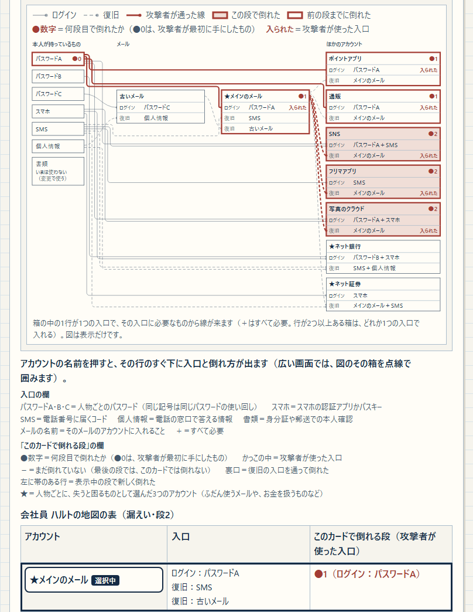
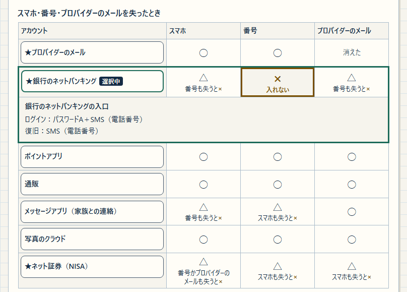
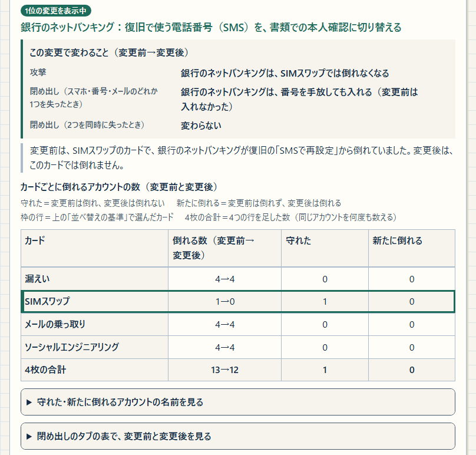

<!--
---
id: day127
slug: account-domino-mapper

title: "Account Domino Mapper"
subtitle_ja: "アカウントの連鎖と閉め出しを比べる教材"
subtitle_en: "Account takeover chains and lockouts, side by side"

description_ja: "架空の3人のアカウントで、1つの攻撃（漏えい・SIMスワップ・メールの乗っ取り・ソーシャルエンジニアリング）が、ログインや復旧を通じて広がる様子を順に見る教材。スマホ・電話番号・メールを失ったときの閉め出しと、入口を1つ変えたとき（認証アプリかパスキーを追加する・必要なものを切り替える・復旧の入口を外す）の前後も比べられる。自分のアカウントの情報は入力せず、外部へは何も送らない。日英対応。"
description_en: "A teaching aid that uses the accounts of three fictional people to show, step by step, how one attack (a breach, a SIM swap, an email takeover or social engineering) spreads through log-in and recovery. It also shows the lockouts after losing the phone, the phone number or an email account, and compares before and after changing one entrance (adding an authenticator app or passkey, switching what it needs, or removing a recovery entrance). Your own account details are never entered, and nothing is sent anywhere. Japanese and English UI."

category_ja:
  - 認証
  - セキュリティマネジメント
category_en:
  - Authentication
  - Security Management

difficulty: 2

tags:
  - account-recovery
  - account-takeover
  - password-reuse
  - sim-swap
  - multi-factor-authentication
  - lockout
  - education
  - visualization

repo_url: "https://github.com/ipusiron/account-domino-mapper"
demo_url: "https://ipusiron.github.io/account-domino-mapper/"
hub: true
---
-->

# Account Domino Mapper - アカウントの連鎖と閉め出しを、入口を1つ変えて比べる教材

[English](README.en.md) · 日本語

[](https://github.com/ipusiron/account-domino-mapper/stargazers)
[](https://github.com/ipusiron/account-domino-mapper/forks)
[](https://github.com/ipusiron/account-domino-mapper/commits)
[](LICENSE)
[](https://ipusiron.github.io/account-domino-mapper/)

**Day127 - 生成AIで作るセキュリティツール200**

Account Domino Mapperは、架空の3人のアカウントを「ログインと復旧の入口」の地図で表し、乗っ取りの連鎖と本人の閉め出しを、入口を1つ変えた前後で比べる教材です。アカウントの強さは、ログインと復旧のうち、いちばん弱い入口で決まります。よそのサービスからの漏えいは防げなくても、連鎖は自分で断てます。

学習用の教材です。本物のアカウントの情報は入力しません（入力する欄もありません）。自分のアカウントは、印刷した用紙に記号で書いて確かめます。

## 🌐 デモページ

👉 **[https://ipusiron.github.io/account-domino-mapper/](https://ipusiron.github.io/account-domino-mapper/)**

ブラウザーで直接お試しいただけます。リポジトリーをダウンロードして`index.html`を`file://`で開いても動き、ビルドやインストールは要りません。

見出しの右端にあるボタン3つは、明暗の切り替え（「暗くする」か「明るくする」）・言語の切り替え（「EN」。英語の画面では「日本語」）・ヘルプと座学（「ヘルプ・座学」）です。言語は、URLの`?lang=ja`か`?lang=en`、保存した選択、ブラウザーの言語の順で決まります。明暗は、保存した選択がなければOSの設定に従います。どちらも、ボタンを押したときだけ保存します。開いているタブはURLの`#`（`#chain`など）に入り、ブラウザーの「戻る」で前のタブと前の位置へ戻れます（保存はしません）。

準備ができるまでは「図と操作を準備中」の案内を出し、操作のボタンを押せないようにしています。JavaScriptが無効のときも説明文を読むことができ、別タブで開き直すリンクも残ります。

## 📸 スクリーンショット

ライトモードの日本語の画面です。ダークモードは見出しの右端の◐、英語の画面はENのボタンで切り替えます。英語の画面の画像は[README.en.md](README.en.md)に載せています。



> *連鎖を追う：会社員 ハルト・漏えい・段2（最後の段）の地図。段1でメインのメール・ポイントアプリ・通販、段2でSNS・フリマアプリ・写真のクラウドが倒れ、合わせて6つです。*



> *閉め出し：高齢の親 シズエの表で銀行のネットバンキングを選んだところ。番号の列で×、スマホとプロバイダーのメールの列で△（番号も失うと×）になり、その行のすぐ下に入口（ログイン：パスワードA＋SMS（電話番号）／復旧：SMS（電話番号））が出ます。*



> *1つ変えて比べる：高齢の親 シズエ・SIMスワップ・上位の変更の先頭「銀行のネットバンキング：復旧で使う電話番号（SMS）を、書類での本人確認に切り替える」の前後。銀行のネットバンキングはSIMスワップでは倒れなくなり、番号を手放しても入れるようになります。*

## ✨ 機能

この教材でする体験は3つです。

1. 連鎖を追う：攻撃カードを1枚選び、使い回しと復旧の入口を通じてアカウントが段ごとに倒れていく様子を見る。多要素を付けたアカウントも、復旧の入口から倒れる（裏口）ことを確かめる。
2. 閉め出しを見る：本人がスマホ・電話番号・メールのどれかを失ったとき、手元に残ったもので入れるか、あと1つ失うと入れなくなるかを見る。復旧の入口は攻撃者の入口であると同時に、本人の戻り道でもある。
3. 1つ変えて比べる：入口を1つ変えたとき（ログインにスマホの認証アプリかパスキーを追加する・入口に必要なものを1つ切り替える・復旧の入口を1つ外す）、攻撃の広がりと閉め出しがどう変わるかを、同じ画面で変更前と変更後に並べる。

| 機能 | 内容 |
| --- | --- |
| 人物（架空） | 会社員 ハルト（アカウント9つ・パスワード3つ）、高齢の親 シズエ（アカウント7つ・パスワード1つ）、学生 ミオ（アカウント7つ・パスワード2つ）の固定の地図。パスワードは人物ごとにA・B・Cの記号で書く。本物のアカウントの情報を入れる欄はない |
| 連鎖を追う | 攻撃カード4枚（漏えい・SIMスワップ・メールの乗っ取り・ソーシャルエンジニアリング）のどれかで、倒れるアカウントを段0から段ごとに追う。攻撃者が使った入口・裏口・倒すのに要るカードを、地図の表と詳細欄に出す |
| 閉め出し | 失うもの3つ（スマホ・番号・メール）を列にした表で、入れる（○）、あと1つ失うと×（△。何を失うと×かを△の下に書く）、入れない（×）、メールそのものがなくなった（消えた）を並べる。名前を押すと、その行のすぐ下に入口が出る |
| 1つ変えて比べる | 3人の変更（会社員41・親24・学生24、合わせて89）から、「並べ替えの基準」の6つごとに、このシミュレーションでの上位の変更を出し、攻撃・閉め出し・2つ同時に失う場合を、変更前と変更後で並べる |
| 規則表 | シミュレーションの規則11行・記号の一覧（入口に必要なものと、表と図の印・線の2つ）・注記4つ（注記1〜4）・このシミュレーションで扱わないもの11項目と、印刷のボタン。上のボタン4つで、タブの中の節へ移る |
| 見どころ | 人物ごとに3つ、合わせて9つ。押すと、その場面のタブ・カード・段・変更へ移る |
| 地図の図 | 幅720px以上の画面で、左の列（パスワードやスマホなど）とアカウントを線で結んだ図（SVG）を表の上に出す。その段で倒れた箱は塗り、前の段までに倒れた箱は太い枠だけにする。攻撃者が通った線は太く描き、ほかの線は薄くする |
| 印刷 | 3人の地図と、自分のアカウントを記号で書く空欄の用紙の4枚（A4） |
| ヘルプと座学 | ヘルプの中へ移るボタン5つ・はじめて読むとき・操作・用語22語・座学10節（各節に表、1〜9節に出典。表は座学の番号で表1-1・表1-2・表2〜表10）・この教材について |
| 日英・明暗 | 日本語と英語、ライトとダークを切り替える。保存するのは言語と明暗の2つだけ |

## 📖 使い方

ヘルプの「はじめて読むとき」と同じ順で進めます。最初に「連鎖を追う」のタブで、会社員の「漏えい」のカードを選び、「次の段 ▶」で1段ずつ進めます。次に人物を高齢の親に替え、見どころの「電話番号を手放すと、ネットバンキングに入れない」を押して、「閉め出し」の表の×を見ます。最後に「1つ変えて比べる」のタブで、同じ高齢の親について上位の変更を押し、変更前と変更後を比べてください。

1. 開いた直後は、会社員 ハルト・漏えいのカード・段0の「連鎖を追う」である。見どころの1つ目「ポイントアプリの漏えいから、6つのアカウントが倒れるまで」を押し、「次の段 ▶」で1段ずつ進める。「◀ 前の段」で1段戻り、「最初から」で段0へ戻り、「最後まで」で最後の段へ移る。カードや人物を替えると段0から始まる。「▶ 再生」は1段ずつ自動で進め、押すと「■ 止める」に変わる。動きを減らす設定のときは、「▶ 再生」を押すとすぐに最後の段を表示し、そのわけを段の行の下に出す。段のボタンを押しても画面は動かない（幅720px未満の画面では、段のボタンと段の行が画面の下に残る）。
2. 地図の表のアカウントの名前を押すと、その行のすぐ下（「…の入口と倒れ方」）に、入口・このカードで倒れる段・攻撃者が使った入口・裏口かどうか・倒すのに要るカードが出る。図では、そのアカウントの箱を点線で囲む。別のタブへ移る見どころは、ボタンに行き先を書き、移った先に「見どころへ戻る」を出す。ブラウザーの「戻る」でも、前のタブと前の位置へ戻る。
3. 攻撃カードや人物を替えると、最後の段から表示する。このとき（倒れるアカウントがあるカードでは）段の行の下に、「最初から」を押すと段0から1段ずつ追えるという案内が出る。「4枚のカードをまとめて見る」を開くと、4枚それぞれで倒れる段を1つの表で比べられる（以下、4枚の一覧）。
4. 「閉め出し」のタブで、スマホ・番号・メールの列の○・△・×を見る。表の上の1行は、その人の表で見るところを示す。名前を押すと、その行のすぐ下にそのアカウントの入口が1つずつ出る（1行にまとめると、例：銀行のネットバンキングの入口：ログイン：パスワードA＋SMS（電話番号）／復旧：SMS（電話番号））。
5. 「1つ変えて比べる」のタブで「並べ替えの基準」（漏えい・SIMスワップ・メールの乗っ取り・ソーシャルエンジニアリング・4枚の合計・閉め出し）を選び、「このシミュレーションでの上位の変更」から変更を押す。見出しの下に、どんな変更が並ぶかの1行と、★（重要なアカウント）・守れる・「4枚の合計」（カード4枚それぞれで数えて足した数）・並びの意味が出る。並んだ変更の先頭（上位の変更の先頭）が、このシミュレーションで1位の変更で、タブを開いたときはこれを選んでいる（比べた結果の見出しに「1位の変更を表示中」と出る）。候補には順位（1・2・3）と、守れる数（閉め出しでは、なくなる数）を大きく出す。順の決め方は、見出しの横の「並べ方」で開く。ほかの変更は、候補のすぐ下の「変更を自分で選ぶ」から選べる。
6. 比べた結果は、変更の文の見出しの下に、要約（攻撃・1つ失ったときの閉め出し・2つ同時に失ったときの閉め出し）、なぜ守れたかの1文、カードごとに倒れるアカウントの数（変更前→変更後）の表、の順で並ぶ。「閉め出しのタブの表で、変更前と変更後を見る」「同じ入口のほかの変え方と比べる」「変更後の地図を見る」（「変更前」「変更後」）で、同じ変更を別の形で確かめる。同じ入口の表の変え方を押すと、その変更の結果が表のすぐ下に出て、押したボタンは画面の同じ位置に残る。表の上と下の「▲ 比べた結果（上）へ戻る」で、変更の文の見出しへ戻る。「変更後の地図を見る」では、地図の攻撃カードを4枚のボタンで選ぶ（最初は、その変更で守れるアカウントがいちばん多いカード。「連鎖を追う」のカードは替わらない）。「変更前」と「変更後」を押し比べると、変わったアカウントに「守れた」「新たに倒れる」の印が付き、変えた入口には「ここを変える」「変えた」の札が付く。違いが出ないカードでは、違いが出るカードへ切り替えるボタンが出る。名前を押すと、その行のすぐ下に変更前と変更後の倒れ方が出る。幅720px未満の画面では、「変更前」「変更後」のボタンが画面の下に残る。
7. 「規則表」のタブで、シミュレーションの規則・記号・注記を読む。タブの上の「このタブの中」のボタンで、規則・記号の一覧・注記・紙に書いて確かめる（印刷）へ移る。自分のアカウントで確かめるときは、「自分のアカウントを紙に書いて確かめる」の「印刷する（3人の地図と空欄の用紙）」で用紙を刷り、記号で書く。「連鎖を追う」のタブの末尾にある印刷への案内（ボタン）からも、ここへ移れる。
8. 見出しの「ヘルプ・座学」で「ヘルプと座学」を開く。上の「このヘルプの中」のボタンで、はじめて読むとき・操作・用語・座学・この教材についてへ移る。座学の本文は、表を「表1-1」「表2」のように番号で指す。タブは←→・Home・Endで移る。ヘルプは「閉じる」・Esc・外側の暗い所で閉じ、開き直すと読んでいた所から続く。

見どころは、「人物（架空）」で選んだ人の3つが「連鎖を追う」のタブに出ます。

| 人物 | 見どころ | 移る場面 |
| --- | --- | --- |
| 会社員 ハルト | ポイントアプリの漏えいから、6つのアカウントが倒れるまで | 連鎖を追う・漏えい・段0 |
| 会社員 ハルト | メインのメールの復旧を、古いメール（予備）から紙の回復コードに切り替える | 1つ変えて比べる・4枚の合計 |
| 会社員 ハルト | ネット証券のパスキーの再登録（復旧）を外すと、スマホをなくしたときに入れない | 1つ変えて比べる・SIMスワップ |
| 高齢の親 シズエ | SIMスワップだけでネットバンキングが倒れる | 連鎖を追う・SIMスワップ・最後の段 |
| 高齢の親 シズエ | 電話番号を手放すと、ネットバンキングに入れない | 閉め出し・銀行のネットバンキング |
| 高齢の親 シズエ | ネットバンキングの再設定を書類での本人確認に切り替えると、SIMスワップでは倒れず、番号を手放しても入れる | 1つ変えて比べる・SIMスワップ |
| 学生 ミオ | ゲームの漏えいが、ネット証券まで広がる | 連鎖を追う・漏えい・段0 |
| 学生 ミオ | 大学のメールを乗っ取られると、7つのアカウントがすべて倒れる | 連鎖を追う・メールの乗っ取り・最後の段 |
| 学生 ミオ | 卒業で、動画のサブスクに入れない | 閉め出し・動画のサブスク（学割） |

印刷は、いまの画面の言語で4枚を刷ります。1〜3枚目は人物ごとの地図の表（攻撃カード4枚と、失ったときの3列）、表の上の列の読み方と★の3行、シミュレーションの注意、4枚目は「わたしの地図（記号で書く用紙）」です。4枚目の上の「保管注意（弱点の地図）」の枠には、書いた日・保管する場所・見直す日の欄があります。その下の空の表18行に、パスワードを書かずに記号で書きます。ブラウザーのメニューから印刷しても同じ4枚になり、ダークモードのままでも黒い文字で刷ります。

## 📐 画面構成

| 場所 | 中身 |
| --- | --- |
| 見出し | 題名と、右端のボタン3つ（明暗の「暗くする」か「明るくする」、言語の「EN」か「日本語」、「ヘルプ・座学」）。マウスを載せると説明が出る |
| 導入 | 2段落。1つの攻撃がログインや復旧を通じて広がる様子を見る教材であることと、入口を1つ変えて比べられること・アカウントの強さがいちばん弱い入口で決まること・タブを見る順番。幅720px未満の画面では短い1文にし、全文は「くわしい説明を読む」で開く |
| 人物（架空） | 会社員 ハルト・高齢の親 シズエ・学生 ミオのボタンと、その人の設定（「ハルトの設定：」など）、アカウントとパスワードの数の1行。幅1000px以上の画面では導入の右に並ぶ |
| タブ | 連鎖を追う・閉め出し・1つ変えて比べる・規則表 |
| フッター | GitHub（ipusiron/account-domino-mapper）へのリンク1つ |

タブとヘルプ、印刷の節の中は、上から次の順に並びます。

- 連鎖を追う：導入、見どころ（「はじめに」の行と番号の付いた3つ）、攻撃カードとその説明の1行とカードの注記、段の操作（その右に操作の案内）、段の行と段の要約、地図の図（幅720px以上。上に凡例、下に見方の1行）、表の見方と凡例（入口の欄・このカードで倒れる段の欄）、地図の表（選んだアカウントの行の下に入口と倒れ方）、4枚のカードをまとめて見る、印刷への案内、上のタブへ戻る
- 閉め出し：導入、凡例（列と印）、その人の表で見るところの1行、名前を押したときの案内、閉め出しの表（選んだアカウントの行のすぐ下に、その入口）、注記3つ
- 1つ変えて比べる：導入と変え方3つ、並べ替えの基準（説明の1行、攻撃カード4枚の段と、4枚の合計・閉め出しの段）、このシミュレーションでの上位の変更（見出しの横に並べ方、見出しの下に何が並ぶかの1行と凡例、高齢の親のときは銀行の変更の順位の1行、その下に順位と数の付いた候補）、変更を自分で選ぶ、比べた結果（何位の変更かの札・要約・なぜ守れたか・カードごとに倒れるアカウントの数・閉め出しのタブの表で、変更前と変更後を見る・注記・同じ入口のほかの変え方と比べる（表のすぐ下に選んだ変更の結果）・変更後の地図を見る（地図の攻撃カード4枚、カードについての1行、変更前と変更後のボタン、図と表。守れた・新たに倒れるの印と、選んだアカウントの行の下に変更前と変更後の倒れ方））
- 規則表：導入、規則の分け方の1行、このタブの中（ボタン4つ）、規則表（単純化したシミュレーション）の11行、記号の一覧（入口に必要なもの・表と図の印と線）、注記4つ（注記1〜4）、このシミュレーションで扱わないもの、自分のアカウントを紙に書いて確かめる
- ヘルプと座学：このヘルプの中（ボタン5つ）、はじめて読むとき、操作（7項目）、用語（22語）、座学（10節）、この教材について
- 印刷の節：3人の地図と空欄の用紙の4枚（画面では隠し、印刷のときだけ出す）

地図の表は、「アカウント」「入口」「このカードで倒れる段（攻撃者が使った入口）」の3列です。3列目には、倒れた段と攻撃者が使った入口（例：●1（ログイン：パスワードA））、最初に乗っ取られたメール（●0（最初に乗っ取られた））、裏口、まだ倒れていないか倒れないもの（－）が出ます。表示中の段で倒れた行には、左の太線が付きます。段に合わせて変わるのは地図の表・図・段の行・選んだアカウントの倒れ方で、段の要約と4枚の一覧はいつも最後の段の結果です。

地図の図は表示だけで、アカウントは下の表の名前で選びます。図の上の端には列の見出し（本人が持っているもの・メール・ほかのアカウント）があり、実線がログイン、破線が復旧の線です。入口の行は「ログイン」か「復旧」で始まり、「入られた」は攻撃者が使った入口です。その段で倒れた箱は塗り、前の段までに倒れた箱は太い枠だけにし、攻撃者が通った線は太く、ほかの線より前に描きます。

画面全体で、色だけに頼らないよう、倒れた段（●段）・裏口・閉め出し（×）・なくなったメール（消えた）・攻撃者が使った入口（入られた）は文字で示し、パスワードは人物ごとの記号（パスワードA・B・C）で書きます。

| 部分 | 幅720px以上 | 幅720px未満 |
| --- | --- | --- |
| 地図の図（SVG） | 表の上に出す。会社員と学生の図（幅960）と親の図は文字14pxで描き、図の枠が図より狭い画面では、図ごと枠の幅まで縮めて出す（横にはスクロールしない） | 出さない（表の題は「…の地図の表」で、表の上に図があることを書く） |
| 地図の表 | 3列（アカウント・入口・このカードで） | 2列（名前の下に入口、右にこのカードでの結果） |
| 閉め出しの表 | 4列（アカウントと失うもの3つ） | 4列のまま（4列が入らない幅では、名前を印の上の行に出す） |
| 攻撃（カード4枚） | 変更前と変更後の倒れる数と、守れた・新たに倒れたアカウントの名前 | 数だけの5列。名前は「守れた・新たに倒れるアカウントの名前を見る」で開く |
| 記号の一覧・閉め出しの表の前後・同じ入口の表 | 表 | 縦に積む |
| 詳細欄 | 名前を押すと、その行のすぐ下に出る。フォーカスは名前に残る | 同じ |

## 🔬 技術的な説明

このシミュレーションは、Hammannらの論文「User Account Access Graphs」（CCS 2019）のアカウントアクセスグラフを、教材に要る分だけに絞ったものです。人物ごとに、資格情報（パスワード・スマホ・電話番号・個人情報・書類での本人確認）とアカウントを節点にし、アカウントの入口ごとに「この条件がそろえば開く」という規則を1つ置きます。計算は`domino-core.js`が行い、画面の文・表・図の座標は`domino-view.js`が作ります。

- 入口：1つのアカウントに入る手段。ログインの入口と、復旧（再設定）の入口がある。論文の「色」に当たる。
- かつ：1つの入口は、その条件がすべてそろったときだけ開く（論文の同じ色の辺）。
- または：入口のどれか1つが開けば、そのアカウントに入れる（論文の違う色の辺）。
- 到達：最初に持っているもの（攻撃者ならカードで最初に手にしたもの、本人なら手元の資格情報）から始めて、条件がそろった入口のアカウントを足していき、新しく加わるものがなくなったところで決まるアカウントの集まり（論文の定義3の最小不動点）。入口ごとにそろっていない条件の数を数えておき、0になった入口のアカウントを足すので、手間は条件の数の合計（図の線の数）に比例する（DowlingとGallierのHorn節の方法）。
- 段：段0は攻撃者が最初に手にしたもの。段rは、条件がすべて段r−1までにそろった入口で倒れたアカウント。攻撃者が使った入口は、そうした入口のうちデータの順で最初のもの。
- 閉め出し：本人が失ったものを地図から外し、手元に残った資格情報から同じ規則で到達できないアカウント（到達の補集合）。本人は、失う前は資格情報をすべて持っているとする。消えたメールそのものは「消えた」と表し、閉め出しに数えない。
- 裏口：そのカードで倒れるが、復旧の入口をまとめて外した地図では倒れないアカウント。論文の定義26（論文の語はbackdoor）を、点数なしの二値にしたもの。画面では「復旧の入口を通って倒れたアカウント」と説明する。

すべての線を「または」とみなす素朴な到達（幅優先探索）は、「かつ」を誤ります。3人の地図でも、会社員のSIMスワップでネット銀行が、親の漏えいで銀行のネットバンキング・メッセージアプリ・ネット証券（NISA）が倒れたことになってしまいます。会社員のネット銀行の再設定はSMS＋個人情報なので、SIMスワップのカード1枚では倒れません（規則2の例）。

論文の定義18は、閉め出しを最小不動点として定めています。この教材は、閉め出しを到達の補集合で数えます。次の2つは、この教材で導いて確かめたことです。1つは、本人が、ほかから開かれることのない資格情報（入る線のない資格情報）をすべて持っているとき、補集合は定義18の規則の最大不動点と同じになることです。この教材では、いつもこの条件を満たします。もう1つは、定義18を最小不動点のまま計算すると、2つのメールが互いを予備にする輪で閉め出しを見落とす場合があることです。メール1とメール2が互いを予備にする輪で、メール1のパスワードとメール2のパスワードを両方失うと、補集合ではメール1とメール2の両方に入れず、定義18の最小不動点では閉め出しが出ません（座学9の表）。補集合で数えるのは、このためです。3人の地図には輪がないので、どちらで数えても同じ結果になります。

漏えいのカードでは、攻撃者は、漏れたサービス（会社員と親はポイントアプリ、学生はゲーム）がいまログインに使っているパスワードを最初に手にします。パスワードを固定せず、データからその場で求めます。このため、漏れたサービスのパスワードをほかと別のもの（その人の次の記号のパスワード。会社員はD、親はB、学生はC）に切り替える変更では、攻撃者が手にするのはその新しいパスワードだけになり、使い回し先へ広がりません。3人とも、漏えいのモードでは上位の変更の先頭がこの変更で、変更後に倒れるのは漏れたサービスの1つだけです。カードが表すのは、そのIDとパスワードがそのまま（平文で）出回った場合です（規則6）。

規則表は、画面の「規則表」のタブと同じ11行です。

| # | 規則 |
| --- | --- |
| 1 | アカウントには入口がある。ログインの入口と、復旧（再設定）の入口がある |
| 2 | 1つの入口の条件は「かつ」。全部そろえば開く（例：パスワード＋SMSのコード） |
| 3 | 入口どうしは「または」。どれか1つ開けば入れる |
| 4 | 攻撃者は、カードで最初に手にしたものから始める。倒れたメールのアカウントも、次の入口の条件に使う。新しく倒れるアカウントがなくなるまで繰り返し、1回の繰り返しで新しく倒れた分を1段と数える |
| 5 | パスワードはA・B・Cなどの記号で表す（人物ごと）。同じ記号なら、どのアカウントでも同じパスワードとみなす（少し変えただけのものを含む） |
| 6 | 漏えいのカードは、漏れたサービスのIDとパスワードが、そのまま（平文で）出回った場合を表す。そのときは、パスワードが長くても、同じパスワードを使う入口ではパスワードの条件がそろう |
| 7 | SMSの条件は、電話番号を持っていれば満たす。攻撃者が電話番号を手にするのは、SIMスワップのカードのときだけ |
| 8 | 電話の窓口は、個人情報を答えられれば再設定に応じる。書類での本人確認（身分証・郵送）を破るカードはない |
| 9 | パスキーと認証アプリはスマホの中の鍵として扱う。紙の回復コードは本人の手元にだけある |
| 10 | 閉め出し＝本人が失ったもの（1つ、または2つ同時）を外し、手元に残ったものから同じ規則で入れないアカウント。消えたメールそのものは「消えた」と表し、閉め出しには数えない。パスワードを忘れることは扱わない |
| 11 | 時間・確率・通知・不審なログインの検知は扱わない |

規則表のタブには、次の注記4つをいつも出します。

注記1（SMS）：攻撃者がSMSのコードを受け取れるのは、SIMスワップのカードのときだけです。根拠の研究（Leeら、SOUPS 2020。携帯会社を調べたのは2019年）は、米国のプリペイドの携帯会社5社を調べたものです。日本の携帯会社でも同じように起きるとは限りません。

注記2（パスキーとスマホ）：パスキーと認証アプリはスマホの中の鍵として扱います。このため、パスキーが偽サイトに強いことは数に出ません。同期したパスキーをクラウドのアカウントの復旧で取り出す経路と、端末の感染で乗っ取る経路は、このシミュレーションでは扱いません。このシミュレーションには、攻撃者がスマホを手にするカードがないので、スマホの認証アプリかパスキーを追加しても、攻撃で倒れるアカウントは増えません。スマホを失ったときの結果は、認証アプリやパスキーを、ほかの端末やクラウドに同期・バックアップしていない場合のものです。

注記3（電話の窓口）：電話の窓口は、個人情報を答えられれば本人とみなす設定です。このシミュレーションには、書類での本人確認を破るカードも、本人が書類をなくす場合もありません。そのため、再設定を書類での本人確認に切り替えても、攻撃で倒れるアカウントも閉め出しも増えません。実際には、書類は偽造されることがあり、窓口での再設定には日数もかかります。実在するサービスの本人確認の手順は、ここには載せていません。

注記4（紙の回復コード）：紙の回復コードは本人の手元にだけあります。このシミュレーションには、攻撃者が紙の回復コードを手にするカードがありません。そのため、紙の回復コードに切り替えても、攻撃で倒れるアカウントは増えません。実際には、紙の置き場所が新しい弱点になります。また、回復コードは手で入力するので、偽サイトに入力すると盗まれます。本人の側では、紙をほかのもの（スマホなど）と一緒になくすと、入れなくなることがあります。紙を分けて保管する方法は、[Day124 Scatter Seeds](https://ipusiron.github.io/scatter-seeds/)と[Day125 Overlay QR Shares](https://ipusiron.github.io/overlay-qr-shares/)で試せます。

変更は、3人の地図の入口から総当たりで作ります（会社員41・親24・学生24、合わせて89通り）。

- 追加：ログインの入口に、スマホの認証アプリかパスキーを追加する。アカウントが多要素を用意していて、その入口にまだスマホがないときだけ（3人で12通り）。
- 切り替え：入口に必要なものを1つ、別の1つに切り替える。メールは、ほかのメールか、復旧なら紙の回復コードに切り替える。SMSは、ログインならスマホに、復旧なら紙の回復コードか書類での本人確認に切り替える。個人情報は、書類での本人確認か、復旧なら紙の回復コードに切り替える。パスワードは、同じパスワードをほかのアカウントでも使っているときだけ、そのアカウントだけのパスワード（その人の次の記号）に切り替える。どれもアカウントが用意している手段に限る（3人で53通り）。
- 外す：復旧の入口を1つ外す。ログインの入口は外さない（3人で24通り。そのうち条件が2つの入口を外す変更は4通り）。

書類・紙の回復コード・スマホへ向かう変更（書類に切り替える7通り・紙の回復コードに切り替える17通り・認証アプリかパスキーを追加する12通り・スマホに切り替える4通りの40通り）は、このシミュレーションでは新たに倒れるアカウントが0で、1つ失ったときの閉め出しが増えることもありません。ただし、攻撃の結果が何も変わらない変更が20通りあり、良くなるとは限りません。2つ同時に失う場合まで見ると、紙の回復コードに切り替える9通りと認証アプリかパスキーを追加する3通りが、新たに閉め出される組を作ります。攻撃で倒れるアカウントが増えないのは、このシミュレーションに、攻撃者が書類・紙の回復コード・スマホを手にするカードがないためです。書類に切り替える変更で閉め出しも増えないのは、本人が書類をなくす場合も扱わないためです（注記3）。実際には書類は偽造されることがあります。

「1つ変えて比べる」の候補は、「並べ替えの基準」の6つごとに並べます。攻撃カード1枚のモード（漏えい・SIMスワップ・メールの乗っ取り・ソーシャルエンジニアリング）と「4枚の合計」では、1つ失ったときの閉め出しを1つでも増やす変更を後ろに回します。そのうえで、差し引きで守れる★（重要なアカウント）の数（多い順）→差し引きで守れる数（多い順）→閉め出しの増減（少ない順）→4枚のカードで新たに倒れる数の合計（少ない順）の順に並べます。「閉め出し」では、閉め出しの増減（減る変更が先）→4枚のカードで新たに倒れる数の合計（少ない順）→差し引きで守れる★の数（4枚の合計、多い順）→差し引きで守れる数（4枚の合計、多い順）の順です。差し引きは、守れた数から、同じカードで新たに倒れた数を引いた数です。「4枚の合計」と「閉め出し」では、どちらもカード4枚それぞれで数えて足した数で引きます（同じアカウントを2回以上数えることがあります）。同点なら追加→切り替え→外すの順です。

「このシミュレーションでの上位の変更」には、条件を満たす変更だけを並べた順に取り、同じ入口からは1つずつ、3つまで出します。条件は、攻撃カード1枚のモードと「4枚の合計」では、差し引きで守れる数が正で、1つ失ったときの閉め出しを増やさないことです。「閉め出し」では、閉め出しが減ることです。どのモードでも、その人が失うもの（「閉め出し」のタブの列）に入っているメール（会社員の古いメール・学生の大学のメール）へ切り替える変更は出しません。解約や卒業で消える予定のメールに頼り直す変更を、上位に並べないためです（「変更を自分で選ぶ」では選べます）。外した変更の代わりに、同じ入口のほかの変更や、並べた順で次の変更が入ります（会社員の漏えいの3位、会社員のSIMスワップの2位と3位、学生のSIMスワップの2位と3位）。このため、上位の変更の先頭は、並べた順で条件を満たす最初の変更です。当てはまる変更がなければ上位の変更を出さず、理由を出します（会社員の「閉め出し」と、学生の「ソーシャルエンジニアリング」）。2つ同時の喪失は並べ方に入れず、候補のボタンに「閉め出し（2つ同時）が…つ増える」として添えます。

3人の地図のネット証券は、ログインにパスキーが必須で、パスキーを再登録する復旧の入口が残る架空の設定です。各社の手順は写していません。学生（ミオ）の再登録を登録メールだけにしたのは教材のための設定で、各社の公開FAQで見た実際の手順（パスワードとSMSの認証を組み合わせるなど）より弱くしてあります。会社員の証券は、再登録の条件「メール＋SMS」のメールがSMSで倒れるので、パスキーが必須でもSIMスワップ1枚で段2に倒れます。端末の感染は扱いません。

`domino-core.js`（計算）・`domino-data.js`（3人のデータ）・`domino-view.js`（候補・文・地図の座標）・`messages.js`（日英の辞書）は、UMD形式の通常のスクリプトです。外部の依存がなく、DOMにも依存しないので、Node.jsから`require`で読めます（テストもこの形で読む）。`app.js`だけがDOMを扱います。人物ごとの計算は1回だけ行って覚え、言語や明暗を替えても計算し直しません。変更後の地図は、段の結果（人物・変更・カードの組ごとに1件）と図の座標（人物・変更・言語の組ごとに1件）を、それぞれ最近使った8件まで覚えます。9件目を覚えるときは、いちばん長く使っていない1件を捨てます。地図の図の座標は、人物ごとにデータの順とメールどうしの依存の深さから決め、力学配置は使いません（図の幅は会社員と学生が960、親が800）。列の幅は中身から決め、メールの列は、ほかのアカウントの列の1枚目のカードの下から始めます。2つ以上の列をまたぐ線は、列の間の縦の道を通って、入口の行の高さをまっすぐ横に進みます。その高さに途中の列のカードがあるときだけ、カードの上か下を回ります。線が重ならないことを確かめるための線の点列は、テストが頼んだときだけ作ります。

## 🎯 ユースケース

このツールならではの使い方

1. 復旧の入口が集まるメールを探す（家庭・職場の研修）：4枚の一覧で、どのカードでも倒れるアカウントを探す。会社員ではメインのメールが4枚すべてで倒れ、カード1枚で倒れるアカウントは4枚のどれでも全9のうち6〜7（メインのメールを含む）。そのうち3〜5は、メインのメールを必要とする復旧の入口から倒れる。自分のアカウントは用紙に記号で書いて同じ問いを当てはめる（研修で使うときも、書いた用紙は本人が保管し、集めたり見せ合ったりしない）。
2. 2つの鍵が同じ電話番号1本から来る（多要素の独立性の議論）：会社員の証券の再登録（メインのメール＋SMS）は、SIMスワップ1枚で段2に倒れる（メインのメールがSMSで倒れるため。倒すのに要るカード＝SIMスワップ1枚）。
3. 論理の授業（かつ・または）：会社員のネット銀行がSIMスワップ1枚では倒れない理由を、入口の「かつ」で説明する（再設定はSMS＋個人情報。倒すのに要るカード＝SIMスワップとソーシャルエンジニアリングの2枚）。
4. 外すか切り替えるかの天秤：3人の89通りの変更のうち、1つ失っただけで閉め出しを増やすのは10通りで、すべて「外す」（外す24通りのうち10通り）。2つ同時まで見ると、追加3通り・切り替え15通りでも新たに閉め出される組ができる。紙の回復コードに切り替えると、閉め出される組が変わることも、新たに組ができることもある（変わらないこともある）。
5. 閉め出しまでの余裕は入口の数では測れない：親の銀行は入口が2つあるが、どちらも電話番号を使うので、番号を手放すだけで入れない（スマホの列でも△（番号も失うと×））。
6. 家族で話し合う：高齢の親の地図を印刷し、電話番号1本に頼る箇所を話し合う。SIMスワップ1枚で銀行が倒れ、番号を手放すと銀行に入れない。銀行の再設定を書類に切り替える1つの変更で両方が止まる（このシミュレーションでは書類の偽造も、本人が書類をなくすことも扱わないので、書類に切り替える変更は攻撃でも閉め出しでも悪くならない。印刷した紙にもシミュレーションの注意が載る）。

ほかの使い方

- 情報リテラシーの授業：教員が学生 ミオの地図で漏えいのカードを選び、パスワードAの使い回しでフリーメール・SNS・ゲームが段1、フリマアプリとネット証券（つみたて）が段2で倒れる流れを見せる。使い回しとリスト型攻撃を、1つの漏えいの続きとして説明できる。
- 社内研修：情報システムの担当者が、ソーシャルエンジニアリングのカードで電話の窓口の入口から倒れる流れを見せ、閉め出しの表で、退職や機種変更のときに本人が入れなくなる場面を話し合う。
- 電話の窓口の研修：コールセンターの担当者が、ソーシャルエンジニアリングのカードで、個人情報だけで通る電話の窓口の入口からどのアカウントまで倒れるかを見て、本人確認の手順が連鎖の起点にもなることを知る。
- 暮らし：卒業を控えた学生や親のスマホの設定を手伝う家族が、卒業・プロバイダーの解約・電話番号の変更の前に、学生の見どころ「卒業で、動画のサブスクに入れない」と親の見どころ「電話番号を手放すと、ネットバンキングに入れない」を見て自分や家族の復旧先を見直す。
- 創作：推理小説や脱出ゲームの作者が、アカウントの連鎖の筋が規則表の規則に合うかを確かめる。手口の手順書にはしない。
- 研究：情報科学の学生や研究者が、Hammannらの形式の入門として、到達の最小不動点と、定義18の輪の反例（座学9）を小さな例で確かめる。
- 組み合わせ：Day083 Intrusion Path Mapperで建物とネットワークの侵入経路を見たあと、この教材でアカウントのつながりを見る。紙の回復コードを分けて保管するならDay124 Scatter Seeds・Day125 Overlay QR Shares、パスワードの強さはDay001 Password Checker、使い回しの重複率はDay019 PassCloud、パスワードスプレーはDay060 Reverse Brute-force Demoとつなげる。

限界

- 単純化したシミュレーションで、実在のサービスの手順は写していない。実際のサービスは、不審なログインの検知や通知も持つ。
- 日本の携帯会社の、SIMの再発行の本人確認の現状は確かめていない。SIMスワップのカードは、SIMスワップが成功したと仮定したシミュレーションである。
- 同期パスキーをクラウドの復旧で取り出す経路と、端末の感染は扱わない。
- 書類の偽造と、パスワードを忘れることは扱わない。
- 書類・紙の回復コード・スマホへ向かう変更は、このシミュレーションでは攻撃で倒れるアカウントを増やさない（良くなるとは限らない）。実際には書類は偽造されることがあり、紙は置き場所で見られたり盗まれたりすることがある。
- 時間・確率・検知・通知は扱わない。
- 自分のアカウントの設定を調べる道具ではない。自分のアカウントは、印刷した用紙に記号で書いて考える。

## 🔒 セキュリティ

- CSPは`default-src 'none'; script-src 'self'; style-src 'self'; img-src 'self' data:; base-uri 'none'; form-action 'none'; frame-src 'none'; object-src 'none'; connect-src 'none'`（`index.html`のmetaで指定）。
- referrerは`<meta name="referrer" content="no-referrer">`で送らない。
- 文字を入れる欄はない（文字の`<input>`・`<textarea>`・`contenteditable`を使わない）。選ぶのはボタンと「変更を自分で選ぶ」の一覧だけである。
- 保存するのは言語と明暗の2つだけ（localStorageの鍵は`account-domino-mapper.language`と`account-domino-mapper.theme`）。はじめて開いたときは保存せず、ボタンを押したときだけ保存する。
- 外部への通信はない（`fetch`・`XMLHttpRequest`・WebSocketを使わず、CSPの`connect-src 'none'`でも止める）。外部のスクリプト・スタイル・フォントを読み込まない。
- 画面の文字は要素とテキストで組み立て、`innerHTML`を使わない。
- 外部へのリンク（座学の出典・関連ツール・GitHub）は、`window.open`を使わない普通のリンク（`target="_blank" rel="noopener noreferrer"`）で、JavaScriptに頼らずに別タブで開く。
- 印刷する用紙には「保管注意（弱点の地図）」の欄があり、写真に撮ったりクラウドやメッセージで送ったりしないよう書いている。

使い回しの情報は、パスワードそのものがなくても攻撃者の役に立ちうるものとして扱われています（MozillaのPassword Reuse Visualizerのwiki）。アカウントのつながりの形そのものを、パスワードとは別に守る対象とする道具もあります（LatticeのREADME）。このため、画面には本物のアカウントの情報を入れる欄を置かず、自分のアカウントは印刷した用紙に記号で書く形にしました。

公開ページの読み込みと、出典へのリンクを開く操作には通常の通信が発生します。入力を送る機能はありません（入力欄もありません）。

出典：[Mozilla「Identity/Watchdog/Password Reuse Visualizer」](https://wiki.mozilla.org/Identity/Watchdog/Password_Reuse_Visualizer)、[LatticeのREADME](https://github.com/vexselene/lattice)

## ⚠️ 注意と限界

**この教材は、自分のアカウントの設定を調べる道具ではありません**。結果は、規則表の11行の規則と、作者が決めた架空の3人の設定から出たものです。実際のサービスの手順は会社ごとに違い、変わることもあります。自分のアカウントの情報は画面に入力せず、印刷した空欄の用紙に記号で書いて考えます。

- 研究の数値（ヘルプの座学）には、調査の年と範囲を添えている。SIMスワップの根拠の研究（Leeら、SOUPS 2020）は、2019年に米国のプリペイドの携帯会社5社を調べたもので、日本の携帯会社でも同じように起きるとは限らない。
- 「スマホをなくした」の値は、認証アプリやパスキーを、ほかの端末やクラウドに移していない（同期・バックアップしていない）場合の値である。
- このシミュレーションで扱わないもの（規則表のタブの一覧と同じ）は、パスワードの強さ、攻撃の確率・手間・時間、不審なログインの検知と通知、同期パスキーをクラウドの復旧で取り出す経路、端末の感染、書類の偽造、パスワードを忘れること、SSOとパスワード管理ソフト、乗っ取ったあとに攻撃者が再設定先を書き換えること、漏れたパスワードがハッシュで守られていて解けない場合、フィッシング（偽サイトでの入力。パスキーはこれに強い）である。認証アプリとパスキーはどちらもスマホの中の鍵として扱う（規則9）ので、パスキーが偽サイトに強いことは数に出ない。
- 閉め出しの表は、4列が入らない狭い画面（幅320pxなど）では、名前を印の上の行に出して、語の途中で折らない。4枚の表と攻撃（カード4枚）の表は、カードの名前を略さずに書くので、幅320pxの画面では表の枠の中で横にスクロールする。それ以外の表と、ほかの幅のすべての表では、語の途中で折らない。
- 読み上げソフトで画面を順に読むと、段の行と読み上げ用の通知に同じ段の文が残っているため、同じ文が2回読まれることがある。
- 確かめたブラウザーはChromiumとFirefoxである。

この教材にないもの

- 自分の地図を作る機能、入力欄、言語と明暗のほかの保存、外部への通信
- 攻撃カード「端末の感染」「書類の偽造」（規則表の注記にだけ書く）
- 復旧の入口に追加する変え方と、2つ以上の入口を同時に変えること
- 攻撃カードを2枚選ぶ操作（2枚が要ることは、詳細欄の「倒すのに要るカード」で示す）
- 失うもの「パスワードを忘れた」と、2つ同時に失ったときの閉め出しを並べ方に入れること
- 残りの入口の数・資格情報の組・点数（論文のaccess setの全列挙と点数）
- しきい値（複数の条件のうちいくつかがそろえば開く形）、SSOとパスワード管理ソフトの節点、ログイン済みのセッション
- 実在のサービスの部品と、実在の事件の地図の上での再現
- 図のドラッグ・拡大と、力学配置
- 乗っ取られたあとの片付け

## 🔗 参考

Day083 Intrusion Path Mapperとの違い

Day083 Intrusion Path Mapperでも、アカウントをノードにして「メールが乗っ取られたらどこまで届くか」を見られます。ただしDay083の経路は1本の道筋で、成功確率は各ノードの値の積です。本ツールは、2つの鍵がそろったときだけ開く「かつ」（多要素）、1つのパスワードが複数のアカウントを同時に開く使い回し、復旧の入口、本人の閉め出しを、決まった規則で扱います。

先行例と、この教材が足すものは次の表のとおりです。

| 先行例（調べた範囲） | 何がある | この教材が足すもの |
| --- | --- | --- |
| [Hammannら（CCS 2019）](https://doi.org/10.1145/3319535.3354193)と[ETHの道具](https://doi.org/10.5905/ethz-1007-306)（Java＋Haskell、Apache-2.0） | かつ・または、閉め出し、裏口の形式と実装。導入が要り、グラフを手で作る | ブラウザーで開くだけの、架空の3人の固定の地図 |
| [DIVINA](https://doi.org/10.1145/2740908.2742836)（Ismailら、WWW 2015） | 質問票から本人の依存を規則にし、閉め出し（safety）を出し、回答を変えて改善を試す。デモは2022年12月以降、404になる | 本物を入れない、手口のカード、攻撃と閉め出しを前後に並べる |
| [DepAuth](https://github.com/Kharacternyk/depauth)（GitHub、GPL-3.0、アプリ） | 自分の構成の依存、侵害の連鎖と到達できない（閉め出し）、any N of。英語だけ | 本物を入れない、手口のカード、前後の比較、日英 |
| [lnschroederのAccount Access Graphs](https://github.com/lnschroeder/account-access-graphs)（GitHub・デモ、MIT） | ブラウザーの作図器、手動解析とaccess base。閉め出しはV_initを外して手で確かめる形。CDNを読む | 閉め出しの表、前後の比較、外部の読み込みなし |
| [PyTac](https://project-archive.inf.ed.ac.uk/ug4/20244135/ug4_proj.pdf)（エディンバラ大学、2024年） | tacticの命令で攻撃の手順を再生（研究試作） | 命令を書かずにカードを選ぶ |
| [AAG Analyser](https://github.com/Digital-Security-Lab/user-account-study-icissp2024)（BüttnerとGruschka、ICISSP 2024） | securityとaccessibilityの点数（HTMLの道具、CDN） | 点数でなく、倒れる順と閉め出しの表 |
| [Karafiliら（ETAA 2018）](https://doi.org/10.1007/978-3-030-04372-8_7) | 最も弱い部品で決まる尺度、what-ifと対策の前後の尺度（Prologの試作） | 同じ考えを、教材の画面で前後に並べる |
| [Firebreak](https://github.com/daviewawesh9-coder/firebreak)（GitHub、MIT、2026-10-20） | 依存なしの静的サイト、架空のデモ人物1人、Breach mode。1段の依存だけで、かつ・使い回し・閉め出しはない。英語だけ | 多段の連鎖、かつ、使い回し、閉め出し、日英 |
| [Number Exit Kit](https://github.com/dawnportinfo-design/number-exit-kit)（GitHub、MIT、2026-07-22） | 電話番号への依存の棚卸し（日英西の画面）。地図でなく表、ビルドが要る | ログインと復旧の入口の地図と攻撃カード |
| [Lockout Drill](https://github.com/McMittens1/lockout-drill)（GitHub、MIT、2026-09-27） | 1つのHTML（file://で開け、CSPはconnect-src 'none'）。Hammannらの形式の、かつ・またはの最小不動点。名前つきの喪失の場面（スマホの盗難・番号の乗っ取り・メールの乗っ取り・火事など）ごとに、各アカウントに入れるか（すぐ・数日・申し立てのみ・不可）と理由の鎖、最小の閉め出しの組を出し、直し方は再計算で確かめて並べる。乗っ取りの場面も本人が失う扱いで、攻撃者の広がりと使い回しはない。見本は実在の製品名の設定1つと、自分の設定の入力。英語だけ | 攻撃の広がり（手口のカード）と閉め出しを同じ画面の前後に並べる、使い回し、本物を入れない架空の3人の固定の地図、日英 |
| [Maat](https://github.com/maat-security/Maat)（GitHub、MIT、2026-08、pre-alpha） | 自分の構成（パスワード管理ソフトの書き出しか質問票）から、アカウント・要素・端末・復旧の線の依存グラフを作り、1つが破られるか失われたときに届く範囲、切断点、互いに復旧し合う輪、要素1つで復旧のないアカウントを示す。直し方の前後は、露出がいちばん大きい場合の数で比べる。SIMスワップも扱う。かつはない。Pythonのデスクトップ（ソースから実行）、英西。同類＝[Continuum](https://github.com/KarunyaChavan/Continuum)（GitHub、MIT、2026-05〜06、デスクトップでビルドが要る。確率で多段に伝わる乗っ取りと、輪の警告）・[BLAST RADIUS](https://github.com/yukthashreegr15ganesh-hub/blast-radius)（GitHub、2026-10。画面の写しから依存を作り、1つの起点からの到達と最小の直しを出す）・[DominoGuard](https://github.com/realRoronoa/DominoGuard)（GitHub、MIT、2026-09、ハッカソンの試作。メールの乗っ取り・SIMスワップ・セッションの乗っ取りで、つながったアカウントへの連鎖を模擬する。外部の漏えい照会を使う） | かつ、使い回しの連鎖、本物を入れない架空の3人、手口のカード、攻撃と閉め出しの両方の前後比較、日英、導入不要 |

このほか、[SentiNet](https://github.com/mekdes1825/SentiNet)（GitHub、2026年9〜10月）は、架空の人物・SIMスワップ・堅牢化の前後比較を持ちますが、モバイルマネーの1つのサービスの中の模擬で、アカウントの間の依存を持ちません。

アカウントの依存を「かつ・または」の規則で表す研究（Hammannら、CCS 2019／Ismailら、DIVINA 2015）、いちばん弱い部品で強さを測り対策の前後を比べる推論器（Karafiliら、ETAA 2018）、自分の構成を描く道具（DepAuth、lnschroederのAccount Access Graphs、Firebreak、Lockout Drillなど）はすでにあります。本ツールは、その形式を、架空の3人と攻撃カードで体験する日英の教材にしたものです。入口を1つ変えたときに、攻撃の広がりと本人の閉め出しがどう変わるかを、同じ画面で前後に並べます。

日英の画面・導入不要・外部の読み込みなし・閉め出しの表・変更の前後比較は、それぞれ単独では上の先行例（Number Exit Kit・Firebreak・Lockout Drill・Maat）にもあります。この教材の差は、架空の人物の固定の地図、手口の名前で選ぶ攻撃カード、攻撃と閉め出しを同じ画面の前後に並べる変更の比較、日英、導入不要で外部の読み込みなし、の組み合わせです。

この組み合わせを持つ教材は、2026-10-29にGitHubの検索とWeb検索で調べた範囲（主な検索語：account access graph、account dependency mapping、account recovery graph、identity dependency graph、account lockout drill、phone number dependency accounts、account takeover simulator、アカウント 乗っ取り 連鎖 可視化）では見当たりませんでした。

参考文献（ヘルプの座学の出典と、同じ主張の先行研究）は次のとおりです。

- Hammann, Radomirović, Sasse, Basin, "User Account Access Graphs", CCS 2019, pp. 1405–1422. DOI [10.1145/3319535.3354193](https://doi.org/10.1145/3319535.3354193)
- Hammann, Crabb, Radomirović, Sasse, Basin, "'I'm Surprised So Much Is Connected': A Study on Users' Online Accounts", CHI 2022. DOI [10.1145/3491102.3502125](https://doi.org/10.1145/3491102.3502125)
- Dowling, Gallier, "Linear-time algorithms for testing the satisfiability of propositional Horn formulae", The Journal of Logic Programming 1(3), pp. 267–284, 1984. DOI [10.1016/0743-1066(84)90014-1](https://doi.org/10.1016/0743-1066(84)90014-1)
- Das, Bonneau, Caesar, Borisov, Wang, "The Tangled Web of Password Reuse", NDSS 2014. DOI [10.14722/ndss.2014.23357](https://doi.org/10.14722/ndss.2014.23357)
- Li, Wang, Sun, "Email as a Master Key: Analyzing Account Recovery in the Wild", IEEE INFOCOM 2018, pp. 1646–1654. DOI [10.1109/INFOCOM.2018.8486017](https://doi.org/10.1109/INFOCOM.2018.8486017)
- Klivan, Höltervennhoff, Huaman, Krause, Simko, Acar, Fahl, "'We've Disabled MFA for You': An Evaluation of the Security and Usability of Multi-Factor Authentication Recovery Deployments", CCS 2023, pp. 3138–3152. DOI [10.1145/3576915.3623180](https://doi.org/10.1145/3576915.3623180)
- Lee, Kaiser, Mayer, Narayanan, "An Empirical Study of Wireless Carrier Authentication for SIM Swaps", SOUPS 2020, pp. 61–79. [USENIX](https://www.usenix.org/conference/soups2020/presentation/lee)
- Büttner, Gruschka, "Evaluating the Influence of Multi-Factor Authentication and Recovery Settings on the Security and Accessibility of User Accounts", ICISSP 2024, pp. 691–700. DOI [10.5220/0012319000003648](https://doi.org/10.5220/0012319000003648)
- Jin, Ji, He, Zhuang, Xu, Tian, "SMS Goes Nuclear: Fortifying SMS-Based MFA in Online Account Ecosystem", DSN-W 2021, pp. 7–14. DOI [10.1109/DSN-W52860.2021.00013](https://doi.org/10.1109/DSN-W52860.2021.00013)
- NIST SP 800-63B-4, "Digital Identity Guidelines: Authentication and Authenticator Management", July 2025. DOI [10.6028/NIST.SP.800-63B-4](https://doi.org/10.6028/NIST.SP.800-63B-4)
- NCSC, "Incidents impacting retailers – recommendations from the NCSC", 2025-05-04. [NCSC](https://www.ncsc.gov.uk/blog-post/incidents-impacting-retailers)
- Honan, "How Apple and Amazon Security Flaws Led to My Epic Hacking", Wired, 2012-08-06. [Wired](https://www.wired.com/2012/08/apple-amazon-mat-honan-hacking/)
- Olshtein, "Pass the Passkey: A Novel Attack Surface in Passwordless Authentication", Palo Alto Networks Unit 42, 2026-08-03. [Unit 42](https://unit42.paloaltonetworks.com/passwordless-authentication-security-risks/)
- [日本郵政「第三者による不正利用および会員情報漏えいの可能性について」2026-10-19](https://files.japanpost.jp/assets/34d9d11432734cfaa759e78fe395b688/8ca4b69b953146bda1823819d3c1f5a3/20261019_01.pdf)
- [JPCERT/CC「STOP! パスワード使い回し!」](https://www.jpcert.or.jp/pr/stop-password.html)
- [総務省「国民のためのサイバーセキュリティサイト」](https://www.soumu.go.jp/main_sosiki/cybersecurity/kokumin/security/end_user/general/01/)
- [総務省「携帯電話の本人確認ルール」](https://www.soumu.go.jp/tokushusagi/id-check/)
- [奈良県警察本部サイバー犯罪対策課「サイバーニュース 令和5年度第4号」](https://www.police.pref.nara.jp/cmsfiles/contents/0000006/6309/cybernews_R5_4.pdf)
- [日本証券業協会「インターネット取引における不正アクセス等防止に向けたガイドライン」（2025-10-15施行）](https://www.jsda.or.jp/about/hatten/inv_alerts/alearts04/files/20251015_internetgl.pdf)
- [金融庁「金融商品取引業者等向けの総合的な監督指針」（2025-10-15適用の改正）](https://www.fsa.go.jp/news/r7/shouken/20251015/20251015.html)
- [金融庁「業界団体との意見交換会において金融庁が提起した主な論点」（2025-07-15開催、日本証券業協会）](https://www.fsa.go.jp/common/ronten/202507/07.pdf)

関連ツールは次のとおりです（ヘルプの座学10と同じ）。

| ツール | 何を学ぶか |
| --- | --- |
| [Day083 Intrusion Path Mapper](https://ipusiron.github.io/intrusion-path-mapper/) | 侵入の経路を、1本の道筋と成功確率で見る |
| [Day001 Password Checker](https://ipusiron.github.io/password-checker/) | パスワードの強さ（この教材は、同じパスワードなら長さを問わない） |
| [Day019 PassCloud](https://ipusiron.github.io/passcloud/) | 使い回しを、集団の重複率で見る |
| [Day060 Reverse Brute-force Demo](https://ipusiron.github.io/reverse-bruteforce-demo/) | パスワードスプレー（この教材が扱うのは、これとは別の、よそで漏れたIDとパスワードの使い回し） |
| [Day064 PatternLock Security Trainer](https://ipusiron.github.io/patternlock-security-trainer/) | 端末のロック（パターン） |
| [Day088 PIN Threat Simulator](https://ipusiron.github.io/pin-threat-simulator/) | 端末のロック（PIN） |
| [Day124 Scatter Seeds](https://ipusiron.github.io/scatter-seeds/) | 紙の保管（秘密分散） |
| [Day125 Overlay QR Shares](https://ipusiron.github.io/overlay-qr-shares/) | 紙の保管（視覚暗号） |

パスワード管理ソフトの点検機能や各社のセキュリティ診断は、1件ずつの点検を得意とします。この教材はそれを置き換えるものではなく、アカウントのつながりを見るための補助です。

## 🧪 テスト

Node.js 22以上で、依存パッケージを入れずに実行できます。

```sh
npm test
```

`npm test`は`node --test "test/**/*.test.js"`を実行します。GitHub Actions（`.github/workflows/test.yml`）が、pushとpull requestのたびに、Node.js 22で構文の確認（`node --check`）と`npm test`を実行します。期待値は`test/vectors.json`（計算部の既知の値）と`test/sample.json`（3人のデータ）から取ります。READMEの数値（機能の表・技術的な説明・このツールならではの使い方・スクリーンショットの説明）は、テストが計算部で出し直して確かめます。規則表・注記・見どころ・関連ツールの表（その下の文を含む）と、使い方の順路・候補の見出し・入口の行の例は`messages.js`の文と比べ、先行例の表・決まった文・ディレクトリー構造もテストで確かめています。

| ファイル | 確かめること |
| --- | --- |
| `test/core.test.js` | 3人の計算の結果が`test/vectors.json`と全キーで一致すること、論文の例と乱数のグラフ150個、2つのJSONのsha256、不正なデータ、すべての線を「または」とみなす到達の誤り、輪の上の閉め出し（到達の補集合と定義18）、漏えいで手にするパスワード、2つ同時の喪失 |
| `test/view.test.js` | 並べ方・上位の変更の先頭・候補と効果の文、変更後の地図（89通り×4枚）とその覚え方（最近使った8件を残し、捨てた1件は計算し直して同じ値になる）、同じ入口の表、閉め出しの表で選んだ行の下に出す入口、地図の座標（線が左の列から右の列へ向かい、途中の列のカードに重ならず、線どうしも重ならない。線の点列は頼んだときだけ作り、頼まないときも同じ図になる）、4枚の一覧の全セル、見どころ9つ、印刷の表、座学の表と出典 |
| `test/text.test.js` | 画面・印刷・座学の文が、テストに書いた既知の文と同じこと、3人のすべての変更の文が日英とも埋まり、英語の文に日本語が残らないこと、閉め出しのセルと2つ同時の文の既知の値 |
| `test/structure.test.js` | CSP・referrer・scriptの並び・入力欄がないこと・乱数と通信と`innerHTML`を使わないこと・保存の鍵2つ・ローカルの絶対パスがないこと・外部リンクの属性・禁止語・実在の名前・ヘルプの並び・OGP（6つのmetaと、og:descriptionがdescription_jaと同じこと、スクリプトが書き換えないこと）・READMEの禁止語と作業の経緯の語 |
| `test/i18n.test.js` | 日英の辞書のキーと差し込み文字、`index.html`の静的な文、英語の値に日本語がないこと（言語ボタンの名前の頭にある、ボタンに見える1字を除く）、言語ボタンの名前が見える文字で始まること、日本語と英数字の間の空白がないこと、用語22語 |
| `test/format.test.js` | 最長行・BOMなし・主要ファイルの行数 |
| `test/contrast.test.js` | ライトとダークの文字のコントラスト比（4.5:1以上）と、フォーカスの輪・図の線と縁のコントラスト比（3:1以上） |
| `test/theme-init.test.js` | 明暗の初期化（OSの設定・保存した選択・保存の失敗・同期の読み込み） |
| `test/readme.test.js` | READMEのYAML・日英の見出しの対応・数値の再計算（機能の表・技術的な説明・このツールならではの使い方・スクリーンショットの説明）・規則表と注記と見どころと関連ツールの表（その下の文を含む）が`messages.js`と同じこと・使い方の順路と候補の見出しと入口の行の例が画面と同じこと・先行例の表と決まった文・画像（PNGとして展開できること・幅808px・300KB以下・6枚が別々の画像で、並びとキャプションがタブの順）・ディレクトリー構造と実際のファイル・ハッキング・ラボ・オンラインへの1行・日本語と英数字の間の空白 |

ブラウザーの検査は、PythonのPlaywright（ChromiumとFirefox）で実行します。CIには入れていません。

```sh
python test/interface.browser.py
python test/startup.browser.py
```

- `test/interface.browser.py`：幅320・390・720・808・1280px、日英、ライトとダークで、`file://`と、一時的に立てたローカルのHTTPサーバーから開き、consoleのエラーとCSP違反がないこと、ページが横にはみ出さないこと、図が縮まないこと、表の形と語の折り返し、段の操作と再生（動きを減らす設定を含む）、見どころ、フォーカスとキーボード、外部リンクが別タブで開くこと、言語ボタンの名前が見える文字で始まること、英語の画面に日本語が残らないこと（言語ボタンに見える1字を除く）、言語を切り替えてもOGPが変わらないこと、印刷（ChromiumでA4のちょうど4ページ）、「1つ変えて比べる」で3人のすべての変更を日英で1つずつ選んで描いたあとのメモリーの増え方（Chromiumで4MB以下）と、変更後の地図のために覚えている段の結果と図の座標が、それぞれ8件までであることを確かめる。
- `test/startup.browser.py`：保存のない状態ではじめて開いたときの表示と、JavaScriptを遅らせた・欠けた・無効にしたときに、説明を読むことができ、操作が無効になっていることを確かめる。
- どちらも、結果の書き出し先を`--output`で指定できる。指定しなければOSの一時フォルダーに書き出し、リポジトリーの中には何も書かない。

## 📁 ディレクトリー構造

```text
account-domino-mapper/        # リポジトリーのルート
|-- .gitattributes            # 改行をLFに保つ（2行：* text=auto eol=lf・*.png binary）
|-- .github/                  # GitHubの設定
|   `-- workflows/            # 自動テストの定義
|       `-- test.yml          # pushとpull_requestのたびに構文の確認（node --check）とnpm test（Node 22）
|-- LICENSE                   # MIT
|-- README.md                 # 日本語の説明（YAMLはここだけ）
|-- README.en.md              # 英語の説明（README.mdと同じ節）
|-- index.html                # 画面（CSP・OGP・起動の型）
|-- style.css                 # 意匠・狭い画面の表の形・印刷
|-- theme-init.js             # 描画の前に明暗を決める（同期で読む）
|-- domino-core.js            # 計算（到達・閉め出し・変更の評価。UMD・DOM非依存）
|-- domino-data.js            # 架空の3人のデータ（sample.jsonのpersonasと同じ）
|-- domino-view.js            # 見せ方の部品（候補・文・地図の座標。DOM非依存）
|-- messages.js               # 日英の辞書
|-- app.js                    # DOMと状態
|-- package.json              # npm testの定義（依存なし）
|-- assets/                   # READMEの画面の画像
|   |-- screenshot.png        # タブ1・会社員・漏えい・最後の段
|   |-- screenshot2.png       # タブ2・親
|   |-- screenshot3.png       # タブ3・親・SIMスワップ・上位の変更の先頭
|   `-- en/                   # 英語の画面
|       |-- screenshot.png    # タブ1（英語）
|       |-- screenshot2.png   # タブ2（英語）
|       `-- screenshot3.png   # タブ3（英語）
`-- test/                     # 自動テストと既知の値
    |-- core.test.js          # A〜E（計算の一致・BFS・輪・漏えいのパスワード・2つ同時）
    |-- view.test.js          # F（並べ方・候補・効果・変更後・同じ入口・座標）
    |-- text.test.js          # G（既知の文・型・日英の行数）
    |-- structure.test.js     # H（CSP・scriptの並び・入力欄なし・禁止語・実在の名前）
    |-- i18n.test.js          # H（日英のキーと差し込み文字・日本語0）
    |-- format.test.js        # H（最長行・BOM・行数）
    |-- contrast.test.js      # H（文字とSVGの線の色の比）
    |-- theme-init.test.js    # H（明暗の初期化）
    |-- readme.test.js        # I（YAML・見出しの対応・数値の再計算・画像・ツリー）
    |-- sample.json           # 3人のデータ（personasはdomino-data.jsと同じ。sha256を固定）
    |-- vectors.json          # 計算の既知の値（テストの期待値。sha256を固定）
    |-- interface.browser.py  # J（PythonのPlaywright。CIに入れない）
    `-- startup.browser.py    # J（保存なしの初回表示。CIに入れない）
```

説明の頭の英字（A〜J）は、テストが確かめるものの分類です（A〜E＝計算、F＝見せ方の部品、G＝文、H＝静的な検査、I＝README、J＝ブラウザーの検査）。

## 💻 動作環境

- HTML・CSS・通常のJavaScript（UMD形式）だけで動く。ビルドも、実行時の外部ライブラリーも要らない。
- `index.html`をブラウザーで開くだけで動く。ダウンロードして`file://`で開いても、GitHub Pagesでも同じである。
- 確かめたブラウザーはChromiumとFirefoxである。ほかのブラウザーは確かめていない。
- 画面はJavaScript・SVG・`<dialog>`を使い、言語と明暗の設定だけをlocalStorageに保存する。
- テストに要るのは、Node.js 22以上（`npm test`）である。ブラウザーの検査には、PythonとPlaywright（ChromiumとFirefox）が要る。通常の利用には、どちらも要らない。

## 📄 ライセンス

ソースコードのライセンスはMIT Licenseです（[LICENSE](LICENSE)。Copyright (c) 2026 ipusiron）。実行時に読み込む外部ライブラリーはありません。参考に挙げた文献・資料には、それぞれの権利が適用されます。

## 🛠️ このツールについて

本ツールは、「生成AIで作るセキュリティツール200」プロジェクトの一環として開発されました。
このプロジェクトでは、AIの支援を活用しながら、セキュリティに関連するさまざまなツールを100日間にわたり制作・公開していく取り組みを行っています。

プロジェクトの詳細やほかのツールについては、以下のページをご覧ください。

🔗 [https://akademeia.info/?page_id=44607](https://akademeia.info/?page_id=44607)

ツールの一覧と学習の入口は、[ハッキング・ラボ・オンライン](https://hackinglab.online/)にまとめています。
